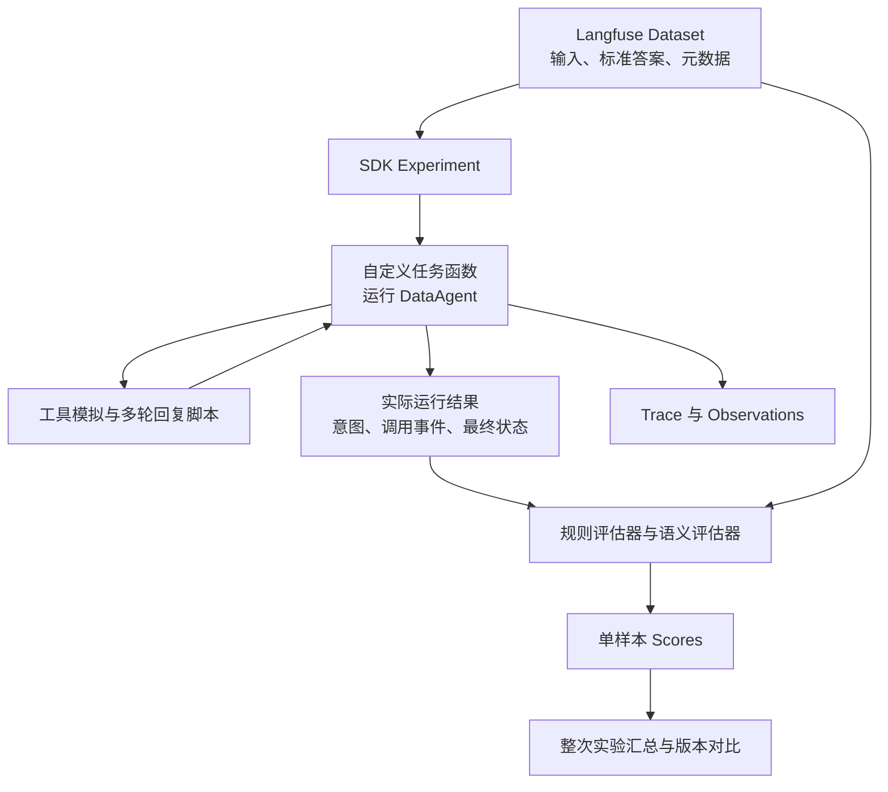

# 过程评测 - 意图识别评测
仅使用端到端结果评分，难以区分意图理解、业务检索、SQL 生成等环节的错误。因此增加模块级评测和轨迹检查，以支持错误定位及组件优化。
> 初始阶段无法概括所有用例, 后续继续补充.

## 1.评测目标与范围
DataAgent 意图识别模块作为 Text-to-SQL 的关键前置环节，需要单独建立 Benchmark 评测体系，用于衡量以下能力

```csv
能力维度,评估重点,重要性
任务类型识别,能否正确识别用户意图,🔴 高
槽位填充完整性,分析维度、筛选条件、时间范围等参数是否完整提取,🔴 高
歧义检测与澄清,能否识别模糊表达并主动发起澄清,🔴 高
触发意图工具,工具调用时机/参数是否准确,🔴 高
可视化建议合理性,推荐的图表类型是否符合数据特征,🟡 中
```

A.评测环境要求

采用 Langfuse 作为评测数据、执行轨迹、评分结果及实验对照的管理平台，通过 SDK Experiments 驱动 DataAgent 意图识别模块。Dataset Item 的 input 存放用户请求及允许使用的固定上下文，expected_output 存放标准意图和预期行为约束，metadata 存放场景分类及标注版本。  

评测任务函数负责 Agent 运行、工具调用拦截或模拟、多轮用户回复及终止条件控制；运行过程中记录工具参数、执行结果和意图状态变化。确定性评估器计算槽位匹配、工具调用及流程约束分数，LLM-as-a-Judge 辅助评估澄清内容，整次实验评估器计算汇总指标。A/B 实验使用相同数据集版本和运行条件，并记录 Prompt、工具定义、模型及评分器版本。


B.意图标签模板
表示必须给用户呈现的意图标签类别，向用户展示模型理解任务情况, 提高后续任务的准确性。

意图标签模板如下所示：
```text
Input: 报表需求描述
Output: 见下方表格
```
```csv
标签类别,展示内容,说明
查询主题,本次查询的简短标题,方便用户快速理解本次任务
查询对象,患者、治疗周期、胚胎、手术记录等,明确查询的业务实体
查询方式,明细查询 / 统计分析,区分数据明细与统计分析
分析类型,单值统计、分组统计、趋势分析、对比分析、排名分析、分布分析、交叉分析,说明用户希望如何分析数据
统计指标,患者数量、治疗周期数、妊娠率等,明确需要统计的业务指标
分析维度,按月份、医生、科室、治疗类型等,明确统计结果按照什么维度组织
筛选条件,治疗类型=IVF、状态=已完成等,明确查询的数据过滤范围
时间条件,时间范围、时间口径、时间粒度,明确统计时间范围及时间计算依据
返回字段,患者编号、年龄、治疗日期等,主要用于明细查询
排序与数量限制,按治疗周期数降序、Top 10 等,有明确排序或数量要求时显示
结果呈现,文字回答、数据表格、柱状图、折线图等,明确结果的展示形式
待确认事项,歧义问题、当前理解、建议选项,让用户确认或修改模型理解
```

页面展示意图的效果UI：
> TODO: 待生成


## 2.工具说明

针对业务需求, 开发了新工具——意图标签发布工具(publish_intent_label), 按照意图模板发布意图标签.
待确认事项则使用澄清决策工具（ask_clarification） 工具获取用户修改/确认反馈.

测试要点：
- 任务分解能力
- 歧义纠正能力


## 3.评测数据集设计

### 3-1 样本分类与比例

```csv
测试类型,测试目标,样本比例,困难等级,数量建议
基础查询匹配,简单指令直接映射到意图标签,20%,easy,40
组合条件查询,多个筛选条件 + 排序+分页,25%,,medium,,50
统计类查询,需要识别分析类型 + 指标+维度,30%,hard,60
歧义表达测试,存在多义性需澄清决策,15%,hard,30
边界长尾场景,非常见业务术语/嵌套逻辑,10%,expert,20
负样本测试,明确不应触发某些意图,≤5%,easy,10
```

### 3-2 评测样本集要求

**A.单轮问答**

```text
Input:[用户 query]
Context: [Agent轨迹(Trace)日志]
Gold Output:
- 无歧义: 调用意图工具发布意图标签(IntentLabelResponse)
- 有歧义：1.调用意图工具发布意图标签(IntentLabelResponse)  2.调用澄清工具发布歧义 (ClarificationRequest)
Ground Truth: 
- 无歧义：人工标注的标准意图标签(JSON)
- 有歧义：人工标注的标准意图标签(JSON) + 歧义问题列表（JSON）
```

注意: Agent轨迹(Trace)日志 = 意图路由 Prompt + 模型推理过程 + 工具调用轨迹

样本集JSON格式：

```json
{
  "id": "intent-001",
  "query": "统计各科室过去半年的患者数量并按降序排列",
  "trace": [
    {
      "role": "system",
      "message": "..."
    },
    {
      "role": "tool",
      "message": "..."
    },
    {
      "role": "assistant",
      "message": ".......<tool-call>...</tool-call>"
    },
    {
      "role": "tool",
      "message": "<tool-response>...</tool-response>"
    },
    // ... 省略更多轨迹
  ],
  "gold_output": {
    "role": "tool",
    "message": "<tool-response>...</tool-response>"   // 意图工具发布标签json字符串
  },
  "ground_truth": {
    "query_theme": "科室患者数量统计",
    "query_object": ["patient", "department"],
    "query_method": "statistical_analysis",
    "analysis_type": "group_by_stat",
    "metrics": [
      {"name": "patient_count", "expression": "COUNT(DISTINCT patient_id)"}
    ],
    "dimensions": [
      {"field": "department", "aggregation": "group_by"}
    ],
    "filters": [],
    "time_condition": {
      "field": "created_at",
      "range": "last_6_months",
      "granularity": "month",
      "calculation_basis": "created_date"
    },
    "sort": [
      {"field": "patient_count", "order": "desc", "implicit": true}
    ],
    "limit": null,
    "presentation": "table",
    "ambiguities": []  // 无歧义
  },
  
  "should_ask_clarification": false,
  "clarification_expectation": [],  // 期望澄清的问题列表
  
  "metadata": {
    "difficulty": "medium",
    "domain": "medical_statistics",
    "template_source": "historical_query_log"
  }
}
```


**B.多轮问答**

① 有歧义的情况, 还未给出任务结果, 用户在歧义基础上继续补充/修正歧义: 
```text
第一轮：
Input:[用户 query]
Context: [Agent轨迹(Trace)日志]
Gold Output:1.调用意图工具发布意图标签(IntentLabelResponse)  2.调用澄清工具发布歧义 (ClarificationRequest)

第二轮：
Input：[用户补充/修正 query]
Context: + 第一轮 [用户query] + [Agent轨迹(Trace)日志] + [意图标签响应(IntentLabelResponse)] + [歧义 (ClarificationRequest)]
         + 第二轮 [Agent轨迹(Trace)日志]
Gold Output: (纠正)调用意图工具发布意图标签(IntentLabelResponse)
```

②上一轮无歧义, 任务直接输出结果, 但是用户不满意, 继续追问

```text
第一轮：
Input:[用户 query]
Context: [Agent轨迹(Trace)日志]
Gold Output:调用意图工具发布意图标签(IntentLabelResponse)

第二轮：
Input：[用户补充/修正 query]
Context: + 第一轮[用户query] + [Agent轨迹(Trace)日志] + [意图标签响应(IntentLabelResponse)] + [模型完成任务结果]
         + 第二轮[Agent轨迹(Trace)日志]
Gold Output: (纠正)调用意图工具发布意图标签(IntentLabelResponse)
TODO: 后续补充多轮对话测试样本示例.
```

### 3-3 歧义问题专项数据集

例如：
- 用户说「统计最近的治疗周期」，最近是指最近一个月还是最近一周？
- 用户说「统计成功率」，成功具体对应哪个业务结果？
- 用户说「统计各医生的患者数量」，是统计医生负责过的患者，还是医生完成治疗的患者？
这类问题不应该简单地以模型是否猜中了某个值来评价，而应该评价模型是否识别出了歧义、是否正确发起澄清。

## 4.评估策略

**A.单体评测**

测试样本集已准备完成，包含以下内容：
- Query：用户原始问题。
- Agent 简化检索轨迹（Trace）：用于还原 Agent 执行意图识别时的上下文及必要的工具返回信息。
- Gold-Output：人工标注的标准结构化意图结果及预期交互决策，作为评测基准。
Agent 意图识别的核心评测对象包括：
- System Prompt：约束 Agent 的意图识别、信息提取及交互决策行为。
- 工具定义（Tool Definition）：包括工具名称、描述、参数 Schema 及相关指令，影响 Agent 的工具选择和参数生成。

**离线评测流程**：
评测系统启动后，读取测试样本，将 System Prompt、工具定义、固定上下文及简化检索轨迹组装为 Agent 执行所需的 Messages，并输入 Query，驱动 Agent 完成意图识别任务。
执行过程中，记录 Agent 的工具调用行为、工具参数及最终 Response，将其与 Gold-Output 进行对照，计算各项评估指标。
为保证评测的独立性和可重复性，离线评测通过工具调用拦截或模拟机制记录执行结果，避免真实业务工具调用产生副作用。

**评估任务触发点**
- 结构化意图提取评测：Agent 调用意图标签发布工具（publish_intent_label）后，捕获工具参数，评估查询对象、统计指标、分析维度、筛选条件、时间条件等信息的提取质量。
- 澄清内容评测：Agent 调用澄清决策工具（ask_clarification）后，捕获澄清内容，评估其是否准确指出歧义，以及是否能够有效引导用户补充必要信息。
- 澄清决策评测：每条测试样本执行结束后，检查 Agent 是否正确决定发起澄清。即使 Agent 未调用 ask_clarification，也需要与标准答案对照，评估漏澄清和过度澄清情况。
- **如果 Agent 没有调用发布工具是整条样本失败**
- 每条样本执行结束后，统一检查意图发布工具是否按要求调用、澄清决策是否正确，以及是否违反必要流程约束。工具未调用的样本仍纳入评估。对多次意图发布，分别评估最终意图正确性和执行过程合规性；草稿阶段的正常修订不直接判错，但错误意图进入下游后再修正，仍记为过程失败。

**自动化评估脚本**
- **传统评估指标**：由程序自动计算，包括 Accuracy、Precision、Recall、F1、Slot F1、Exact Match 等。
- **语义质量评估**：采用 Jev / Teacher-LLM 模型（LLM-as-a-Judge）辅助评估澄清问题的合理性、针对性及完整性，并结合人工抽检校验评估结果。


**B.版本迭代对照实验**

Agent框架意图识别核心组件有两个模块组成：`System Prompt` 和 `工具定义(定制 Prompt)`.

为了独立验证修改后的效果, 设置A/B对照实验, 每次只修改一个核心组件.

修改 System Prompt 时, A-修改前, B-修改后.
修改 工具定义(定制 Prompt) 时, A-修改前, B-修改后.

例如：
```csv
实验,A 组,B 组,目的
实验一,原 System Prompt,新 System Prompt,验证提示词修改效果
实验二,原工具定义,新工具定义,验证工具描述及参数 Schema 修改效果
实验三,原有组件组合,优化后的组件组合,验证整体效果
```

### 5.评估指标
0. 意图工具执行准确率

判断必须发布意图但没有调用工具，整条样本判为意图识别失败.

$$
意图发布调用正确率=\frac{发布或不发布的行为符合预期的样本数}{适用样本总数}
$$


1. Slot Precision / Slot Recall / Slot F1
Slot 可以理解为一个结构化信息槽位，意图标签发布时需要填充非常多的槽位, 
可以将模型提取结果与标准答案进行逐项匹配。
公式：
$$Slot\ Precision=\frac{正确提取的Slot数量}{模型提取的Slot总数量}$$ 
$$Slot\ Recall=\frac{正确提取的Slot数量}{标准答案中的Slot总数量}$$
$$Slot\ F1=\frac{2\times Slot\ Precision\times Slot\ Recall} {Slot\ Precision+Slot\ Recall}$$
例如：
```csv
标准答案,模型输出,结果
指标：完成周期数,指标：完成周期数,正确
维度：医生,维度：医生,正确
时间：最近一年,时间：最近三个月,错误
条件：治疗类型=IVF,条件：治疗类型=IVF,正确
```

模型一共提取了 4 个 Slot，其中 3 个正确，标准答案也是 4 个 Slot。

1. Exact Match（完全匹配率）
Slot F1 允许部分正确，但 Exact Match 要求一条样本中的所有目标信息都正确。
$$ Exact\ Match= \frac{所有目标Slot均正确的样本数}{总样本数}$$
例如有 100 条样本：
- 70 条样本的所有意图信息均正确。
- 20 条样本有一个或多个 Slot 错误。
- 10 条样本有多个 Slot 错误。
那么：
$$Exact\ Match=\frac{70}{100}=70\%$$

1. Accuracy / Precision / Recall / F1-score
$$Accuracy=\frac{预测正确的样本数}{总样本数}$$
$$Precision=\frac{TP}{TP+FP}$$
$$Recall=\frac{TP}{TP+FN}$$
$$F1=\frac{2\times Precision\times Recall} {Precision+Recall}$$
这里的符号含义：
```csv
符号,含义
TP,正确识别的正样本
FP,错误识别为正样本
FN,实际为正样本，但模型漏识别
TN,正确识别的负样本
```

例如，评估模型能否识别「趋势分析」：
- TP：实际为趋势分析，模型也识别为趋势分析。
- FP：实际不是趋势分析，模型却识别为趋势分析。
- FN：实际是趋势分析，模型却没有识别出来。
- TN：实际不是趋势分析，模型也没有识别为趋势分析。

1. 歧义识别：Precision / Recall / F1
将歧义识别看作二分类任务：
- 正样本：用户问题确实存在需要澄清的歧义。
- 负样本：用户问题不存在必须澄清的歧义。
使用前面介绍的 Precision、Recall、F1 进行评估。
其中尤其要关注 Recall：
$$Ambiguity\ Recall=\frac{正确识别的歧义样本数}{实际歧义样本数}$$
如果 Recall 很低，说明模型经常没有发现用户表达中的歧义，可能直接按照错误的理解生成 SQL。

1. 漏澄清率（Missed Clarification Rate）
表示实际需要澄清的问题中，模型没有发起澄清的比例。
$$漏澄清率=\frac{FN}{TP+FN}$$
它实际上等于：
$$漏澄清率=1-歧义识别Recall$$
数值越低越好。

1. 过度澄清率（Over-clarification Rate）
表示实际不需要澄清的问题中，模型却发起了澄清的比例。
$$过度澄清率=\frac{FP}{FP+TN}$$
数值越低越好。
这两个指标需要一起关注：
- 漏澄清率高：模型容易自作主张，可能导致查询结果错误。
- 过度澄清率高：模型频繁打断用户，影响使用体验。

## 5. Langfuse SDK 自动化评估

本方案自动化评估由Langfuse接管, 需要采用Langfuse官方SDK的要求.

流程如下：



官方 SDK 支持：
- Item-level evaluators：评估每条样本。
- Run-level evaluators：对整次实验进行汇总。

建议按下面的方式实现：
```csv
层级,建议记录或计算的内容
单样本,Slot TP / FP / FN、Slot F1、意图 Exact Match、发布调用检查、澄清决策检查、过程约束检查
整次实验,Micro Slot F1、分类 Macro-F1、漏澄清率、过度澄清率、过程通过率、各业务切片结果
```


容易踩的坑：

**(1)对每条样本的 F1 取平均，得到的是样本平均 F1，不是 Micro-F1**

Micro-F1 应先汇总所有样本的 TP、FP、FN，再计算：
\[
Micro\text{-}F1 =
\frac{2\sum TP}
{2\sum TP+\sum FP+\sum FN}
\]
同样，漏澄清率的分母必须是“需要澄清的样本数”，不能直接对所有样本上的某个 0/1 分数取平均。

因此，建议使用 Run-level evaluator 计算这些指标..

**(2) Langfuse LLM-as-a-Judge 版本更新**

根据目前的 LLM-as-a-Judge 官方文档，新设计应优先使用 Observation 级评估或实验评估；旧的 Trace 级托管评估器正在被弃用。

更关键的是：Observation 级评估器不会自动读取同一 Trace 中所有兄弟或子节点。

例如，把 Judge 配置在 ask_clarification 这个工具节点上，它不一定能直接看到：
- 用户的原始问题；
- 前面的业务检索结果；
- 已发布的意图；
- 后续用户回复。
所以，如果你让它判断“这次澄清是否必要、是否问对”，必须显式提供这些必要信息。可以选择：
1. 在 SDK 自定义评估器中组装上下文并调用 Judge；
2. 在被评估的 Observation 上记录必要的输入、输出和上下文摘要，再配置平台托管 Judge。