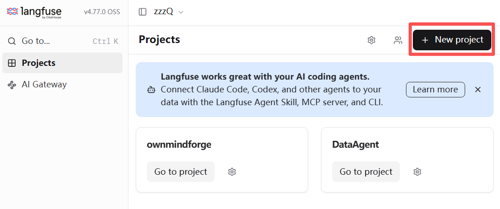
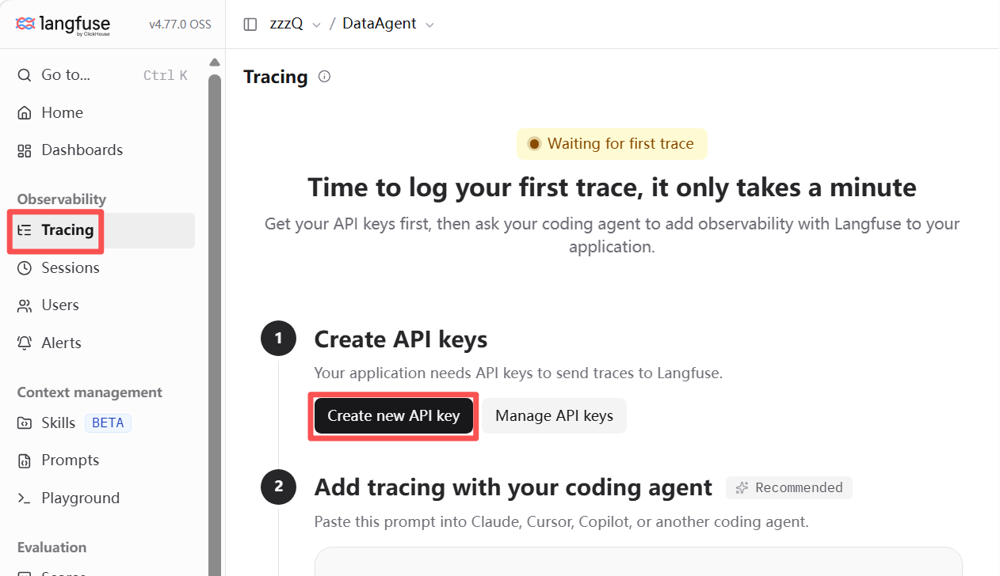

# Langfuse自动化评测指南

## 1.项目启动及轨迹对接

> 以下均为 Docker 方式部署, 方便维护和更新.

克隆官方仓库, 项目根目录修改 docker-compose.yaml 文件, 把默认端口修改至开发需求...处理后, 执行指令启动Langfuse项目:
```bash
docker compose up -d
```

网页打开 `http://127.0.0.1:6001`(按照自己修改端口), 打开后需要先注册账号, Langfuse默认不提供管理员账号.

本指南全局默认账号统一:
```text
账号: langfuse@user.com
密码: langfuse123..
```
> 后续所有操作均在该账号下执行.

登陆后首页为空白项目, 先新建项目：


然后点击左侧菜单栏的 Trace 模块, 新增轨迹对接配置API:



注意保存参数和属性值:
```text
LANGFUSE_SECRET_KEY="sk-lf-xxx"
LANGFUSE_PUBLIC_KEY="pk-lf-xxx"
LANGFUSE_BASE_URL="http://127.0.0.1:6001"
```

随后在Agent服务之下, 安装Langfuse-SDK, 默认情况下, 就能自动记录Agent的运行轨迹.

