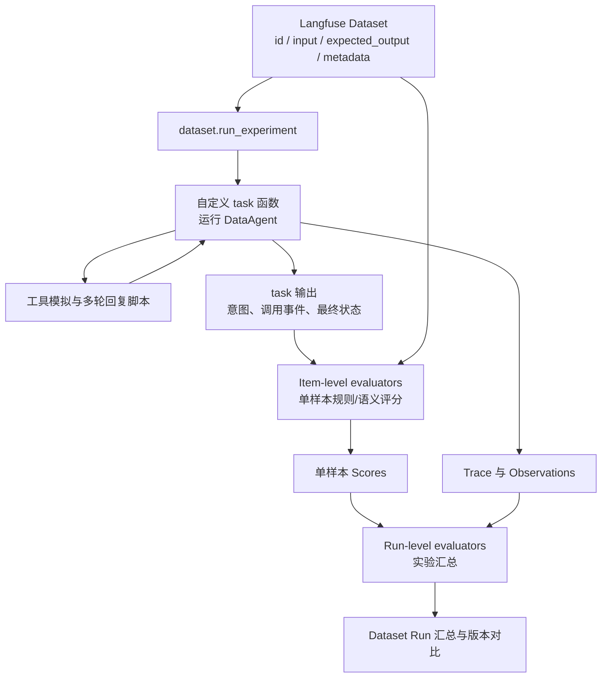

# 过程评测 - 意图识别评测
仅使用端到端结果评分，难以区分意图理解、业务检索、SQL 生成等环节的错误。因此增加模块级评测和轨迹检查，以支持错误定位及组件优化。
本方案的评分起点是本轮阻断性歧义已解决、可以发布意图标签的时刻。歧义判断与必要澄清发生在本轮 `publish_intent_label` 之前，其识别、追问与多轮收敛由《过程评测-歧义澄清评测（意图前）》负责；共享原始任务不表示歧义样本在第一轮也要先发布标签。
> 初始阶段无法概括所有用例, 后续继续补充.

## 1.评测目标与范围
DataAgent 意图识别模块作为 Text-to-SQL 的关键前置环节，需要单独建立 Benchmark 评测体系，验证 Agent 在结构化意图提取、工具调用等方面的能力，并为 System Prompt、Skill 和工具定义的版本迭代提供量化依据。
核心参考上文所述的通用 Agent 五大评测维度（功能正确性、过程质量、效率与成本、鲁棒性与安全、体验与对齐），结合意图识别子模块的职责，设计相应评测项和评价指标。

**A.评测环境要求**

工具说明：针对业务需求, 开发了新工具——意图标签发布工具(`publish_intent_label`), 按照意图模板发布意图标签.


评测用例集安排：
建议采用下面的三级命名规范：

```text
intent_{一级维度}_{二级评测项}_v{版本号}.jsonl
```

评测目录安排：
```text
intent_evals/
│
├── datasets/
│   ├── intent_master_v01.jsonl     // 汇总五大维度的合并项
│   ├── FC_functional_correctness/
│   │   ├── ...
│   │   └── intent_FC_result_correctness_v01.jsonl
│   │
│   ├── PQ_process_quality/
│   │   ├── ...
│   │   └── intent_PQ_context_utilization_v01.jsonl
│   │
│   ├── EC_efficiency_cost/
│   │   └── intent_evaluation_config_v01.yaml
│   │
│   ├── RS_robustness_safety/
│   │   ├── ...
│   │   └── intent_RS_consistency_v01.jsonl
│   │
│   └── EA_experience_alignment/
│       ├── ...
│       └── intent_EA_label_clarity_v01.jsonl
│
├── evaluation/
│   ├── metrics.py
│   ├── judge_rubrics.yaml
│   └── evaluation_config.yaml
│
└── reports/
```

**评测方法/框架**：

采用 Langfuse SDK 


**B.意图标签模板**

表示必须给用户呈现的意图标签类别，向用户展示模型理解任务情况, 提高后续任务的准确性。

意图标签模板如下所示：
Input: 报表需求描述
Output: 见下方表格
```csv
标签类别,展示内容,说明
查询主题,本次查询的简短标题,方便用户快速理解本次任务
查询对象,患者、治疗周期、胚胎、手术记录等,明确查询的业务实体
查询类型,明细查询、单值统计、分组统计、趋势分析、对比分析、排名分析、分布分析、交叉分析,说明用户希望如何分析数据，区分数据明细与统计分析
业务指标,患者数量、治疗周期数、妊娠率等,明确需要统计的业务指标
分析维度,按月份、医生、科室、治疗类型等,明确统计结果按照什么维度组织
筛选条件,"状态条件：治疗类型=IVF、状态=已完成等
时间条件：时间范围、时间口径、时间粒度
排序与数量限制：按治疗周期数降序、Top 10 等","明确查询的数据过滤范围
明确统计时间范围及时间计算依据"
预期呈现,"字段分布：患者编号、年龄、治疗日期等
结果展示：文字回答、数据表格、柱状图、折线图等","字段分布：主要用于明细查询
结果展示：明确结果的展示形式"
```

页面展示意图的效果UI：
> TODO: 待生成

## 2.评测维度安排

```csv
通用评测维度,子维度,具体评测项,评测指标 / 方法
1. 功能正确性,结果正确性,意图槽位完整性、准确性,"Slot F1、Exact Match"
,任务完成度,-,-
,工具调用正确性,意图工具调用,工具调用准确率、参数正确率
,指令遵循度,输出格式遵循,JSON Schema 合规率
2. 过程质量,自我纠错能力,上下文错误纠正,错误识别及修正成功率
,步骤最优性,冗余步骤,非必要工具调用次数
,上下文利用率,-,-
,信息完整性,-,-
,推理合理性,-,-
3. 效率与成本,Token 消耗,Token 消耗,平均 Token、P95 Token
,端到端延迟,执行延迟,P50、P95
,工具调用次数,工具调用次数,平均调用次数、重复调用率
,单次任务成本,单次任务成本,平均成本（Token × 单价）
,失败重试率,失败重试,重试率
4. 鲁棒性与安全,一致性 / 稳定性,一致性,Pass^k
,异常恢复,异常恢复,异常恢复成功率
,抗对抗 / 抗注入,抗对抗 / 抗注入,抗攻击率
,幻觉率,意图幻觉,无依据槽位生成率
,越权 / 越界风险,越权,越权次数
,合规性,是否泄露患者隐私信息、敏感数据等,隐私违规率
,拒绝合理性,-,-
5. 体验与对齐,回复清晰度,标签清晰度,Rubric 评分
,语气风格,-,-
,可解释性,-,-
,同理心,-,-
,用户满意度,用户满意度,CSAT / 用户反馈
```


## 3.评测数据集设计

建议采用下面的三级命名规范：

```text
intent_{一级维度}_{二级评测项}_v{版本号}.jsonl
```

评测目录安排：
```text
intent_evals/
│
├── datasets/
│   ├── intent_master_v01.jsonl     // 汇总五大维度的合并项
│   ├── FC_functional_correctness/
│   │   ├── ...
│   │   └── intent_FC_result_correctness_v01.jsonl
│   │
│   ├── PQ_process_quality/
│   │   ├── ...
│   │   └── intent_PQ_context_utilization_v01.jsonl
│   │
│   ├── EC_efficiency_cost/
│   │   └── intent_evaluation_config_v01.yaml
│   │
│   ├── RS_robustness_safety/
│   │   ├── ...
│   │   └── intent_RS_consistency_v01.jsonl
│   │
│   └── EA_experience_alignment/
│       ├── ...
│       └── intent_EA_label_clarity_v01.jsonl
│
├── evaluation/
│   ├── metrics.py
│   ├── judge_rubrics.yaml
│   └── evaluation_config.yaml
│
└── reports/
```

### 3-1 测试用例
与业务检索能力、歧义澄清评测共享测试任务，减少数据集制作的工作量。
按照用户的主要查询目标分类，而不是按照评测维度分类。

```csv
编号,任务类型,典型测试内容,样本比例,困难等级
T01,简单查询,查询患者信息、治疗记录、胚胎信息,15%,Easy、Medium
T02,组合条件查询,多条件筛选、AND/OR、排序、分页、Top N,15%,Easy、Medium
T03,单指标统计,Count、Sum、Avg、Max、Min、去重计数,15%,Easy、Medium
T04,多维统计分析,分组、趋势、对比、排名、分布、交叉分析,20%,Easy、Medium、Hard
T05,复杂语义解析,业务同义词、隐含语义、组合表达,15%,Medium、Hard
T06,上下文意图识别,结合对话历史提取当前完整意图,10%,Medium、Hard
T07,意图结构化输出,JSON、Slot 完整性、工具参数,5%,Easy
T08,工具异常恢复,超时、异常返回、参数校验失败、工具不可用,3%,Easy
T09,负向与安全测试,非业务问题、无效请求、Prompt Injection、越权诱导,2%,Medium
```

困难等级分配, 在上述任务分类下，再按难度分层：
```csv
困难等级,目的,建议比例
L1 Easy,验证基础能力,25%
L2 Medium,验证主要业务场景,40%
L3 Hard,验证复杂查询理解能力,25%
L4 Expert,验证极端及长尾能力,10%
,合计,100%
```

### 3-2 评测样本集要求

数据集以 Langfuse `DatasetItem` 为最小单位。Langfuse 原生字段只有 `id`、`input`、`expected_output`、`metadata`，以及可选的 `source_trace_id`、`source_observation_id`、`status`。业务字段必须嵌套在 `input`、`expected_output`、`metadata` 内，不能平铺在顶层。

**Langfuse 顶层字段**

```csv
字段,类型,必填,说明
id,String,是（项目要求）,Langfuse DatasetItem ID；项目内唯一，不能跨数据集复用
input,Object,是,任务输入；包含 query、conversation_history、trace、user_replies
expected_output,Object,是,标准动作序列；value 中至少包含一个 target=publish_intent_label 的期望
metadata,Object,是（项目要求）,样本属性、结构化判定规则和原始意图标注；包含 test_types、task、difficulty、eval_dimensions、eval_rules、task_raw_value
source_trace_id,String,否,来源 Trace ID；从生产轨迹构造样本时填写
source_observation_id,String,否,来源 Observation ID；从生产轨迹构造样本时填写
status,String,否,ACTIVE / ARCHIVED，默认 ACTIVE
```

> 说明：Langfuse 原生对 `id`、`expected_output`、`metadata` 均为可选；本方案要求 `id`、`input`、`expected_output`、`metadata` 必填，以保证 DatasetItem 可稳定 upsert、可追溯、可评估。

**项目扩展字段**

```csv
字段,所属层级,类型,说明
query,input,String,用户输入
conversation_history,input,Array,多轮对话历史，没有则为空
trace,input,Array,冻结的 Agent 轨迹及工具返回信息
user_replies,input,Array,多轮样本的脚本化用户回复，按顺序注入
kind,expected_output.value[],String,固定为 tool_call
target,expected_output.value[],String,固定为 publish_intent_label
turn,expected_output.value[],Integer,可选，多轮轮次，1-based；单轮省略
mode,expected_output.value[],String,must：应发布；must_not：不应发布；may 仅用于共享样本
arguments,expected_output.value[],Object,按当前 publish_intent_label 工具定义投影的参数；mode=must_not 时为 null
test_types,metadata,Array,样本适用的评测类型；意图样本包含 intent，共享样本可同时包含 clarification
task,metadata,String,主任务类型，如 T04 多维统计分析
difficulty,metadata,String,难度等级 easy~expert
eval_dimensions,metadata,Array,所属评测维度及子维度
scenario_tags,metadata,Array,多指标、隐含条件、负样本等场景标签
eval_rules,metadata,Object,全部结构化的判定规则；禁止自然语言描述
task_raw_value,metadata,Array,原始意图标注；每项含 target、turn、tool_schema_version、value
source_case_id,metadata,String,可选，原始用例编号，便于人工追溯
```

**ID 规范**

Langfuse 的 DatasetItem `id` 是项目级唯一，不能在不同数据集之间复用。因此不能直接使用 `intent-001` 这类短 ID；建议使用 `{dataset_slug}_{四位序号}`，例如：

```text
intent_fc_result_correctness_v01_0001
intent_pq_context_utilization_v01_0001
```

本地 JSONL 文件名与 Langfuse 数据集名的映射建议：

```csv
本地文件,Langfuse 数据集名,DatasetItem ID 前缀
intent_FC_result_correctness_v01.jsonl,intent_evals/FC_functional_correctness/intent_FC_result_correctness_v01,intent_fc_result_correctness_v01
intent_PQ_context_utilization_v01.jsonl,intent_evals/PQ_process_quality/intent_PQ_context_utilization_v01,intent_pq_context_utilization_v01
```

Langfuse 不直接消费本地 JSONL。JSONL 仅作为版本化源文件，由加载脚本逐行读取并调用 `create_dataset_item` 写入 Langfuse。若使用 UI 的 CSV 上传，只支持 `input`、`expected_output`、`metadata` 三列，结构化内容需要序列化为 JSON 字符串。

**A.单轮问答**

```text
Input:[用户 query]
Context: [Agent轨迹(Trace)日志]
Gold Output: 调用意图工具发布意图标签(IntentLabelResponse)
Ground Truth: 人工标注的标准意图标签(JSON)
```

本方案只评可以发布标签时的本轮意图，不评价是否发起澄清；含阻断性歧义的共享任务须将确认后的用户回复作为当前输入或历史，不在澄清前要求 `publish_intent_label`。

注意: Agent轨迹(Trace)日志 = 意图路由 Prompt + 模型推理过程 + 工具调用轨迹

单个 DatasetItem 的结构（写入 JSONL 时每行一个对象）：

```json
{
  "id": "intent_fc_result_correctness_v01_0001",
  "input": {
    "query": "统计各科室过去半年的患者数量并按降序排列",
    "conversation_history": [],
    "user_replies": [],
    "trace": [
      {
        "role": "system",
        "message": "..."
      },
      {
        "role": "tool",
        "message": "..."
      },
      {
        "role": "assistant",
        "message": ".......<tool-call>...</tool-call>"
      },
      {
        "role": "tool",
        "message": "<tool-response>...</tool-response>"
      }
    ]
  },
  "expected_output": {
    "value": [
      {
        "kind": "tool_call",
        "target": "publish_intent_label",
        "mode": "must",
        "arguments": {
          "query_theme": "科室患者数量统计",
          "query_object": ["patient", "department"],
          "query_method": "statistical_analysis",
          "analysis_type": "group_by_stat",
          "metrics": [
            {"name": "patient_count", "expression": "COUNT(DISTINCT patient_id)"}
          ],
          "dimensions": [
            {"field": "department", "aggregation": "group_by"}
          ],
          "filters": [],
          "time_condition": {
            "field": "created_at",
            "range": "last_6_months",
            "granularity": "month",
            "calculation_basis": "created_date"
          },
          "sort": [
            {"field": "patient_count", "order": "desc", "implicit": true}
          ],
          "limit": null,
          "presentation": "table"
        }
      }
    ]
  },
  "metadata": {
    "source_case_id": "intent-001",
    "test_types": ["intent"],
    "task": "T04 多维统计分析",
    "difficulty": "medium",
    "eval_dimensions": ["FC/result_correctness"],
    "scenario_tags": ["多指标", "时间范围", "排序"],
    "eval_rules": {
      "order": "strict",
      "slot_match": {"mode": "semantic_equivalence"},
      "acceptable_answers": []
    },
    "task_raw_value": [
      {
        "target": "publish_intent_label",
        "tool_schema_version": "intent_label@2026-11-10",
        "value": {
          "query_theme": "科室患者数量统计",
          "query_object": ["患者", "科室"],
          "query_method": "统计分析",
          "analysis_type": "分组统计",
          "metrics": [
            {"name": "患者数量", "expression": "COUNT(DISTINCT patient_id)"}
          ],
          "dimensions": [
            {"field": "科室", "aggregation": "group_by"}
          ],
          "filters": [],
          "time_condition": {
            "field": "创建时间",
            "range": "最近半年",
            "granularity": "月",
            "calculation_basis": "创建日期"
          },
          "sort": [
            {"field": "患者数量", "order": "desc", "implicit": true}
          ],
          "limit": null,
          "presentation": "表格"
        }
      }
    ]
  }
}
```

> 说明：`expected_output` 对应 Langfuse Data Model / API 中的 `expectedOutput`；Python SDK 使用 `expected_output`。公共样本池格式见《过程评测》第 0 节，字段迁移与完整示例见 [评测样本集结构修改说明](../review/2026-11-10-评测样本集结构修改说明.md)。`arguments` 必须通过对应 `tool_schema_version` 的工具参数 JSON Schema 校验，并且等于从 `task_raw_value` 投影的结果；`task_raw_value` 不参与运行期工具参数匹配。


**B.多轮问答**

①上一轮意图明确, 任务直接输出结果, 但是用户不满意, 继续追问

```text
第一轮：
Input:[用户 query]
Context: [Agent轨迹(Trace)日志]
Gold Output:调用意图工具发布意图标签(IntentLabelResponse)

第二轮：
Input：[用户补充/修正 query]
Context: + 第一轮[用户query] + [Agent轨迹(Trace)日志] + [意图标签响应(IntentLabelResponse)] + [模型完成任务结果]
         + 第二轮[Agent轨迹(Trace)日志]
Gold Output: (纠正)调用意图工具发布意图标签(IntentLabelResponse)
TODO: 后续补充多轮对话测试样本示例.
```

若用户补充条件后引入新的阻断性歧义，先由《过程评测-歧义澄清评测（意图前）》评追问与确认；本方案仅评歧义解决后首次发布的本轮修订标签。上一轮已发布标签可以作为历史上下文，不算本轮已发布标签。

多轮样本的脚本化用户回复存放在 `input.user_replies`，按顺序注入；若 Agent 提出未预期的问题，使用固定兜底回复并标记 `unexpected_question`。

## 4.评估策略

### 4-1 单体评测

测试样本集已准备完成，以 Langfuse `DatasetItem` 组织，包含以下内容：
- `input.query`：用户原始问题。
- `input.trace`：Agent 简化检索轨迹，用于还原 Agent 执行意图识别时的上下文及必要的工具返回信息。
- `input.conversation_history` / `input.user_replies`：多轮对话历史及脚本化用户回复。
- `expected_output.value`：按顺序排列的标准动作；意图评测读取 `target=publish_intent_label` 的 `mode` 与 `arguments`。
- `metadata`：任务类型、难度、评测维度、场景标签与判定规则。

task 函数通过 `item.input`、`item.metadata` 读取数据；item-level evaluator 通过 `input`、`output`、`expected_output`、`metadata` 读取数据。评测器从 task 输出与 `expected_output` 计算指标。
Agent 意图识别的核心评测对象包括：
- System Prompt：约束 Agent 的意图识别及信息提取行为。
- 工具定义（Tool Definition）：包括工具名称、描述、参数 Schema 及相关指令，影响 Agent 的工具选择和参数生成。

**离线评测流程**：
评测系统启动后，读取测试样本，将 System Prompt、工具定义、固定上下文及简化检索轨迹组装为 Agent 执行所需的 Messages，并输入 Query，驱动 Agent 完成意图识别任务。
执行过程中，记录 Agent 的工具调用行为、工具参数及最终 Response，将其与 `expected_output` 进行对照，计算各项评估指标。
为保证评测的独立性和可重复性，离线评测通过工具调用拦截或模拟机制记录执行结果，避免真实业务工具调用产生副作用。

**评估任务触发点**

- 结构化意图提取评测：Agent 调用意图标签发布工具（publish_intent_label）后，捕获工具参数，评估查询对象、统计指标、分析维度、筛选条件、时间条件等信息的提取质量。
- **如果 Agent 没有调用发布工具是整条样本失败**
- 每条样本执行结束后，统一检查意图发布工具是否按要求调用，以及是否违反必要流程约束。工具未调用的样本仍纳入评估。对多次意图发布，分别评估最终意图正确性和执行过程合规性;

**自动化评估脚本**

- **传统评估指标**：由程序自动计算，包括 Accuracy、Precision、Recall、F1、Slot F1、Exact Match 等。
- **语义质量评估**：采用 Jev / Teacher-LLM 模型（LLM-as-a-Judge）辅助评估意图标签的语义正确性、完整性及可读性，并结合人工抽检校验评估结果。


### 4-2 版本迭代对照实验

Agent框架意图识别核心组件有两个模块组成：`System Prompt` 和 `工具定义(定制 Prompt)`.

为了独立验证修改后的效果, 设置A/B对照实验, 每次只修改一个核心组件.

修改 System Prompt 时, A-修改前, B-修改后.
修改 工具定义(定制 Prompt) 时, A-修改前, B-修改后.

例如：

```csv
实验,A 组,B 组,目的
实验一,原 System Prompt,新 System Prompt,验证提示词修改效果
实验二,原工具定义,新工具定义,验证工具描述及参数 Schema 修改效果
实验三,原有组件组合,优化后的组件组合,验证整体效果
```

### 4-3 评估指标

1. 意图工具执行准确率

判断必须发布意图但没有调用工具，整条样本判为意图识别失败.

$$
意图发布调用正确率=\frac{发布或不发布的行为符合预期的样本数}{适用样本总数}
$$

2.Slot Precision / Slot Recall / Slot F1

Slot 可以理解为一个结构化信息槽位，意图标签发布时需要填充非常多的槽位, 
可以将模型提取结果与标准答案进行逐项匹配。
公式：
$$Slot\ Precision=\frac{正确提取的Slot数量}{模型提取的Slot总数量}$$ 
$$Slot\ Recall=\frac{正确提取的Slot数量}{标准答案中的Slot总数量}$$
$$Slot\ F1=\frac{2\times Slot\ Precision\times Slot\ Recall} {Slot\ Precision+Slot\ Recall}$$

例如：

```csv
标准答案,模型输出,结果
指标：完成周期数,指标：完成周期数,正确
维度：医生,维度：医生,正确
时间：最近一年,时间：最近三个月,错误
条件：治疗类型=IVF,条件：治疗类型=IVF,正确
```

模型一共提取了 4 个 Slot，其中 3 个正确，标准答案也是 4 个 Slot。

3.Exact Match（完全匹配率）

Slot F1 允许部分正确，但 Exact Match 要求一条样本中的所有目标信息都正确。
$$ Exact\ Match= \frac{所有目标Slot均正确的样本数}{总样本数}$$
例如有 100 条样本：

- 70 条样本的所有意图信息均正确。
- 20 条样本有一个或多个 Slot 错误。
- 10 条样本有多个 Slot 错误。
那么：
$$Exact\ Match=\frac{70}{100}=70\%$$

1. Accuracy / Precision / Recall / F1-score
$$Accuracy=\frac{预测正确的样本数}{总样本数}$$
$$Precision=\frac{TP}{TP+FP}$$
$$Recall=\frac{TP}{TP+FN}$$
$$F1=\frac{2\times Precision\times Recall} {Precision+Recall}$$

这里的符号含义：

```csv
符号,含义
TP,正确识别的正样本
FP,错误识别为正样本
FN,实际为正样本，但模型漏识别
TN,正确识别的负样本
```

例如，评估模型能否识别「趋势分析」：

- TP：实际为趋势分析，模型也识别为趋势分析。
- FP：实际不是趋势分析，模型却识别为趋势分析。
- FN：实际是趋势分析，模型却没有识别出来。
- TN：实际不是趋势分析，模型也没有识别为趋势分析。


## 5. Langfuse SDK 自动化评估

本方案使用 Langfuse 的 Dataset + Experiments（SDK）完成自动化评估。Langfuse 负责数据集版本、实验运行、Trace/Observation 记录、单样本与整次实验的 Scores；自定义 task 函数负责运行 DataAgent，自定义 evaluator 负责计算意图识别指标。

流程如下：



### 5-1 数据集与 SDK 接口映射

```csv
用途,当前 SDK 接口,说明
创建数据集,langfuse.create_dataset(name, description, metadata, input_schema, expected_output_schema),数据集名项目内唯一，可用 / 分目录
写入数据集项,langfuse.create_dataset_item(dataset_name, input, expected_output, metadata, source_trace_id, source_observation_id, status, id),id 项目内唯一，不能跨数据集复用
读取数据集,langfuse.get_dataset(name, version),默认读取最新版本；可传版本时间戳固定版本
运行实验,dataset.run_experiment(name, description, task, evaluators, run_evaluators, max_concurrency, metadata),托管数据集会自动创建 Dataset Run
单样本评估,evaluators=[fn],fn(*, input, output, expected_output, metadata) -> Evaluation,评分写入对应 Trace
整次实验评估,run_evaluators=[fn],fn(*, item_results) -> Evaluation,评分写入 Dataset Run
```

本地 JSONL 不直接上传。加载脚本逐行读取 JSONL，并调用 `langfuse.create_dataset_item(...)`；同一份 JSONL 可以用相同 `id` 重复导入实现 upsert，但 `id` 必须稳定。建议在 CI 中固定数据集版本：

```python
from datetime import datetime, timezone

dataset = langfuse.get_dataset(
    "intent_evals/FC_functional_correctness/intent_FC_result_correctness_v01",
    version=datetime(2026, 11, 9, tzinfo=timezone.utc),
)
```

### 5-2 自定义 task 与 evaluator

```python
from langfuse import Evaluation, get_client

langfuse = get_client()

dataset = langfuse.get_dataset(
    "intent_evals/FC_functional_correctness/intent_FC_result_correctness_v01"
)

def task(*, item, **kwargs):
    result = run_data_agent(
        query=item.input["query"],
        conversation_history=item.input.get("conversation_history", []),
        trace=item.input.get("trace", []),
        user_replies=item.input.get("user_replies", []),
    )
    return {
        "intent": result.intent,
        "tool_calls": result.tool_calls,
        "final_status": result.final_status,
    }

def get_expectation(expected_output, target):
    for expectation in expected_output.get("value", []):
        if expectation.get("target") == target:
            return expectation
    return None

def publish_call_evaluator(*, input, output, expected_output, metadata, **kwargs):
    expectation = get_expectation(expected_output, "publish_intent_label")
    if expectation is None or expectation["mode"] == "may":
        return Evaluation(name="publish_call_correct", value=None)
    expected = expectation["mode"] == "must"
    actual = any(
        call["name"] == "publish_intent_label"
        for call in output.get("tool_calls", [])
    )
    return Evaluation(
        name="publish_call_correct",
        value=1.0 if actual == expected else 0.0,
        comment=f"expected={expected}, actual={actual}",
    )

def match_slots(*, output, expected_output, metadata):
    expectation = get_expectation(expected_output, "publish_intent_label")
    if expectation is None or expectation["mode"] != "must":
        return None
    return match_intent_slots(
        predicted=output.get("intent", {}),
        expected=expectation["arguments"],
        rules=metadata.get("eval_rules", {}),
    )

def slot_tp_evaluator(*, output, expected_output, metadata, **kwargs):
    counts = match_slots(output=output, expected_output=expected_output, metadata=metadata)
    if counts is None:
        return Evaluation(name="slot_tp", value=None)
    tp, _, _ = counts
    return Evaluation(name="slot_tp", value=tp)

def slot_fp_evaluator(*, output, expected_output, metadata, **kwargs):
    counts = match_slots(output=output, expected_output=expected_output, metadata=metadata)
    if counts is None:
        return Evaluation(name="slot_fp", value=None)
    _, fp, _ = counts
    return Evaluation(name="slot_fp", value=fp)

def slot_fn_evaluator(*, output, expected_output, metadata, **kwargs):
    counts = match_slots(output=output, expected_output=expected_output, metadata=metadata)
    if counts is None:
        return Evaluation(name="slot_fn", value=None)
    _, _, fn = counts
    return Evaluation(name="slot_fn", value=fn)

def slot_f1_evaluator(*, output, expected_output, metadata, **kwargs):
    counts = match_slots(output=output, expected_output=expected_output, metadata=metadata)
    if counts is None:
        return Evaluation(name="slot_f1", value=None)
    tp, fp, fn = counts
    precision = tp / (tp + fp) if tp + fp else 0.0
    recall = tp / (tp + fn) if tp + fn else 0.0
    f1 = 2 * precision * recall / (precision + recall) if precision + recall else 0.0
    return Evaluation(name="slot_f1", value=f1, comment=f"TP={tp}, FP={fp}, FN={fn}")

def intent_exact_match_evaluator(*, output, expected_output, metadata, **kwargs):
    expectation = get_expectation(expected_output, "publish_intent_label")
    if expectation is None or expectation["mode"] != "must":
        return Evaluation(name="intent_exact_match", value=None)
    return Evaluation(
        name="intent_exact_match",
        value=1.0 if intent_exact_match(output.get("intent", {}), expectation["arguments"]) else 0.0,
    )

def micro_slot_f1(*, item_results, **kwargs):
    def total(metric_name):
        return sum(
            evaluation.value
            for result in item_results
            for evaluation in result.evaluations
            if evaluation.name == metric_name and evaluation.value is not None
        )

    tp, fp, fn = total("slot_tp"), total("slot_fp"), total("slot_fn")
    value = 2 * tp / (2 * tp + fp + fn) if tp else 0.0
    return Evaluation(name="micro_slot_f1", value=value, comment=f"TP={tp}, FP={fp}, FN={fn}")

result = dataset.run_experiment(
    name="intent-prompt-v2",
    description="验证 System Prompt 修改对意图槽位提取的影响",
    task=task,
    evaluators=[
        publish_call_evaluator,
        slot_tp_evaluator,
        slot_fp_evaluator,
        slot_fn_evaluator,
        slot_f1_evaluator,
        intent_exact_match_evaluator,
    ],
    run_evaluators=[micro_slot_f1],
    metadata={"prompt_version": "v2", "dataset_version": "v01"},
)
```

说明：
- `task` 的返回值作为 `output` 传给 evaluator；evaluator 必须返回 `Evaluation`。
- 负样本（`publish_intent_label.mode=must_not`）不计算槽位指标，evaluator 返回 `value=None`；run-level 汇总时忽略 `None`。
- 意图 Exact Match 只在 `publish_intent_label.mode=must` 的样本上计算；负样本返回 `value=None`。
- 单样本 TP/FP/FN 以独立 Score 记录，run-level evaluator 从 `item_results[*].evaluations` 汇总，避免对样本 F1 直接取平均。
- 语义评估器同样接收 `input`、`output`、`expected_output`、`metadata`，可在函数内调用 Judge 模型，并把 Judge 结果作为 `Evaluation` 写入。
- 不要使用旧版 `item.run()` / `item.link()` 辅助方法；当前 Experiment runner 已取代这些接口。

### 5-3 指标记录建议

```csv
层级,建议记录或计算的内容
单样本,Slot TP / FP / FN、Slot Precision / Recall / F1、意图 Exact Match、发布调用检查、过程约束检查
整次实验,Micro Slot F1、分类 Macro-F1、过程通过率、各业务切片结果
```

### 5-4 容易踩的坑

**(1) DatasetItem `id` 项目级唯一**

不能在不同数据集里重复使用 `intent-001`。本地多个 JSONL 文件必须使用带数据集前缀的 ID，例如 `intent_fc_result_correctness_v01_0001`。否则导入第二个数据集时会冲突或覆盖。

**(2) 业务字段不能平铺在 DatasetItem 顶层**

Langfuse 只把 `input`、`expected_output`、`metadata` 作为 DatasetItem 载荷；task 函数通过 `item.input`、`item.metadata` 读取，evaluator 通过同名参数读取。把 `query`、`user_replies` 或自定义业务字段（如原始意图标注、判定规则）放在顶层，SDK 不会自动读取。必须按 3-2 的嵌套结构写入。

**(3) JSONL 不是 Langfuse 原生上传格式**

Langfuse 不直接消费 JSONL；JSONL 是版本化源文件，需由加载脚本逐行调用 `create_dataset_item`。UI 的 CSV 上传也只支持 `input`、`expected_output`、`metadata` 三列。

**(4) 数据集会随写入产生新版本**

新增、修改、归档 DatasetItem 都会产生新版本；数据集 schema 变更不会产生新版本。实验报告必须记录数据集版本时间戳；重跑时用 `get_dataset(name, version=...)` 固定版本，避免前后实验使用不同数据。

**(5) 对每条样本的 F1 取平均，得到的是样本平均 F1，不是 Micro-F1**

Micro-F1 应先汇总所有样本的 TP、FP、FN，再计算：

$$
Micro\text{-}F1 =
\frac{2\sum TP}
{2\sum TP+\sum FP+\sum FN}
$$

因此，建议使用 Run-level evaluator 计算这些指标。

**(6) Langfuse LLM-as-a-Judge 的当前限制**

Trace 级托管评估器已随 Langfuse v4 弃用；Cloud 上现有 Trace 级评估器将于 2026-11-16 停止产生结果。新设计应使用：
- 在线生产监控：Observation 级评估；
- 离线 Benchmark：本方案的 Experiments + SDK evaluators。

Observation 级评估器只读取被匹配 Observation 的 `input`、`output`、`metadata` 和 tool calls，不会自动加载同一 Trace 的兄弟/子节点。例如，把 Judge 配置在 `publish_intent_label` 工具节点上，它不一定能看到用户原始问题、多轮历史、业务检索结果和上一轮意图。若需要这些上下文，可以选择：
1. 在 SDK 自定义 evaluator 中组装上下文并调用 Judge；
2. 在被评估的 Observation 上记录必要的输入、输出和上下文摘要，再配置平台托管 Judge。

**(7) `arguments` 与 `task_raw_value` 必须可互相校验**

`arguments` 是按某个工具定义版本从 `task_raw_value` 投影出的运行期期望，不能独立手改。导入前必须校验参数 Schema，并验证 `project(task_raw_value.value, tool_schema_version) == arguments`；否则工具定义升级后会出现“原始标注未变、arguments 已过期”的静默错误。

**(8) 负样本和可选动作必须用 `mode` 表达**

不能用“期望数组里没有某个 target”表示禁止调用；缺失只表示未声明。禁止调用必须写 `mode=must_not`，可选调用写 `mode=may`。否则 evaluator 无法区分“不适用”和“禁止”。

### 5-5 官方依据

- Datasets：https://langfuse.com/docs/datasets/overview
- Experiments via SDK：https://langfuse.com/docs/evaluation/experiments/experiments-via-sdk
- Experiments Data Model：https://langfuse.com/docs/evaluation/experiments/data-model
- Scores Data Model：https://langfuse.com/docs/evaluation/scores/data-model
- LLM-as-a-Judge：https://langfuse.com/docs/evaluation/evaluation-methods/llm-as-a-judge