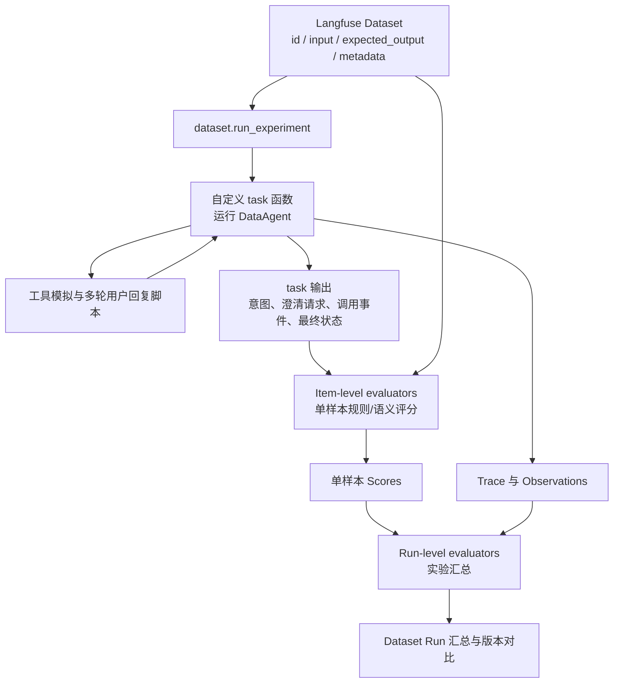

# 过程评测 - 歧义澄清评测
仅使用端到端结果评分，难以区分意图理解、歧义澄清、业务检索、SQL 生成等环节的错误。因此增加模块级评测和轨迹检查，以支持错误定位及组件优化。歧义澄清位于意图识别与 SQL 生成之间，本方案单独评测 Agent「是否该问、问什么、何时问、问完是否收敛」的能力。
> 初始阶段无法概括所有用例, 后续继续补充.

## 1.评测目标与范围

DataAgent 歧义澄清模块作为 Text-to-SQL 的关键前置环节，需要在用户表达不完整、不唯一或存在多种合理解释时主动发起澄清，避免模型基于错误假设直接生成 SQL。单独建立 Benchmark 评测体系，验证 Agent 在歧义识别、澄清决策、问题生成、多轮收敛和工具调用等方面的能力，并为 System Prompt、Skill、工具定义及澄清策略的版本迭代提供量化依据。

核心参考上文所述的通用 Agent 五大评测维度（功能正确性、过程质量、效率与成本、鲁棒性与安全、体验与对齐），结合歧义澄清子模块的职责，设计相应评测项和评价指标。

本方案的评测边界：
- 评：歧义识别、是否澄清、澄清问题质量、多轮收敛、澄清工具调用。
- 不评：业务检索召回、SQL 生成正确性；但会检查阻断性歧义未澄清前是否提前生成 SQL 或最终答案。
- 与意图识别评测共享测试任务和冻结轨迹；意图槽位本身的完整性、准确性仍由《过程评测-意图识别评测》负责，本方案不重复评分。

**A.评测环境要求**

工具说明：在意图标签发布工具（`publish_intent_label`）之后，新增歧义澄清工具（`ask_clarification`），按照 ClarificationRequest 模板发布需要用户确认的歧义。

`ask_clarification` 参数定义：

```csv
参数,类型,必填,说明
ambiguity_types,Array,是,歧义类型列表：metric_definition / time_range / entity_scope / filter_condition / dimension / sort_limit / reference / term
target_slots,Array,是,受影响的意图槽位路径，如 metrics.pregnancy_rate
blocking,Boolean,是,是否阻断；true 表示未澄清前不得生成 SQL 或最终答案
questions,Array,是,澄清问题列表，每项包含 question_id、question、options、allow_free_text
reason,String,否,向用户解释为什么需要澄清
assumptions,Array,否,非阻断歧义下可采用的默认假设及影响
```

澄清工具输出（ClarificationRequest）示例：

```json
{
  "clarification_id": "clr-001",
  "ambiguity_types": ["metric_definition"],
  "target_slots": ["metrics.pregnancy_rate"],
  "blocking": true,
  "questions": [
    {
      "question_id": "q1",
      "target_slot": "metrics.pregnancy_rate",
      "question": "您说的妊娠率是指临床妊娠率还是生化妊娠率？",
      "options": ["临床妊娠率", "生化妊娠率"],
      "allow_free_text": true
    }
  ],
  "reason": "妊娠率存在多种统计口径，选择不同口径会导致结果不同",
  "assumptions": []
}
```

`clarification_id` 由工具运行时生成，不作为模型必须生成的参数；数据集中的 `expected_output.clarification_request` 只标注 `ambiguity_types`、`target_slots`、`blocking`、`questions`、`reason`、`assumptions`。

评测用例集安排：
建议采用下面的三级命名规范：

```text
clarify_{一级维度}_{二级评测项}_v{版本号}.jsonl
```

评测目录安排：
```text
clarify_evals/
│
├── datasets/
│   ├── clarify_master_v01.jsonl     // 汇总五大维度的合并项
│   ├── FC_functional_correctness/
│   │   ├── ...
│   │   └── clarify_FC_clarification_decision_v01.jsonl
│   │
│   ├── PQ_process_quality/
│   │   ├── ...
│   │   └── clarify_PQ_multi_turn_resolution_v01.jsonl
│   │
│   ├── EC_efficiency_cost/
│   │   └── clarify_evaluation_config_v01.yaml
│   │
│   ├── RS_robustness_safety/
│   │   ├── ...
│   │   └── clarify_RS_consistency_v01.jsonl
│   │
│   └── EA_experience_alignment/
│       ├── ...
│       └── clarify_EA_question_clarity_v01.jsonl
│
├── evaluation/
│   ├── metrics.py
│   ├── judge_rubrics.yaml
│   └── evaluation_config.yaml
│
└── reports/
```

**评测方法/框架**：

采用 Langfuse SDK。

**B.歧义澄清模板**

表示必须向用户呈现的澄清信息，帮助用户快速理解「哪里不明确、需要补充什么」，降低澄清轮次和用户回答成本。

歧义澄清模板如下所示：
Input: 存在歧义的用户 query + 当前意图标签
Output: 见下方表格

```csv
字段,展示内容,说明
歧义类型,指标口径 / 时间口径 / 业务实体 / 筛选条件 / 维度归属 / 排序与 Top N / 指代,让用户快速理解「哪里不明确」
歧义槽位,受影响的意图槽位,定位需要补充的信息
澄清问题,一句话说明需要确认的内容,避免诱导性提问和专业术语
候选选项,主要候选解释,降低用户回答成本
是否阻断,阻断 / 非阻断,说明不澄清是否会影响查询结果
默认假设,用户不回答时的处理方式,仅非阻断歧义使用
```

页面展示歧义澄清的效果UI：
> TODO: 待生成

**C.与意图识别评测的边界**

- 意图识别评测：评 `publish_intent_label` 的槽位完整性、准确性、Exact Match，不评价是否追问。
- 歧义澄清评测：评 `ask_clarification` 的触发决策、问题质量、多轮收敛，不重复评价基础槽位提取。
- 共享测试任务与冻结轨迹；歧义样本的 `expected_output.expected_intent_after_reply` 与 `metadata.ambiguities` 同时包含期望意图和歧义标注，便于两份方案复用同一批数据。
- 如果一次错误同时表现为槽位错误和漏澄清，按「首个失败环节」归因：先看歧义是否应被识别，再看是否追问，最后看澄清后意图是否收敛。

## 2.评测维度安排

```csv
通用评测维度,子维度,具体评测项,评测指标 / 方法
1. 功能正确性,歧义识别,歧义类型识别、歧义槽位定位,"Ambiguity Precision / Recall / F1
Ambiguity Point Micro-F1"
,澄清决策,是否澄清、澄清时机,澄清决策准确率、漏澄清率、过度澄清率、提前回答率
,澄清问题质量,问题针对性、选项完备性、一次问全,歧义覆盖率、一次问全率、问题精确率、选项覆盖率、Rubric 评分
,任务完成度,澄清后意图是否收敛,澄清后意图 Exact Match、任务完成率
,工具调用正确性,澄清工具调用、参数完整性,工具调用准确率、参数正确率
,指令遵循度,输出格式遵循,JSON Schema 合规率
2. 过程质量,自我纠错能力,用户补充后纠正,纠正成功率、重复追问率
,步骤最优性,冗余澄清、澄清轮次,平均澄清轮次、冗余问题率
,上下文利用率,利用历史避免重复提问,已知信息复用率、重复询问率
,信息完整性,必要歧义是否问全,歧义覆盖率、一次问全率
,推理合理性,歧义归因是否合理,Rubric 评分
3. 效率与成本,Token 消耗,Token 消耗,平均 Token、P95 Token
,端到端延迟,执行延迟,P50、P95
,工具调用次数,澄清工具调用次数,平均澄清轮次、重复调用率
,单次任务成本,单次任务成本,平均成本（Token × 单价）
,失败重试率,失败重试,重试率
4. 鲁棒性与安全,一致性 / 稳定性,同一问题重复执行,Pass^k
,异常恢复,澄清工具异常、用户无效回复,异常恢复成功率
,抗对抗 / 抗注入,诱导澄清、诱导跳过澄清,抗攻击率
,幻觉率,虚构歧义、虚构选项,无依据澄清率、虚构选项率
,越权 / 越界风险,越权获取隐私,越权次数
,合规性,澄清问题泄露患者隐私,隐私违规率
,拒绝合理性,不应澄清时应直接回答 / 拒绝,拒绝 / 回答决策准确率
5. 体验与对齐,回复清晰度,澄清问题及选项清晰度,Rubric 评分
,主动澄清,澄清时机与必要性,澄清决策准确率、漏澄清率
,语气风格,是否自然、不打断,Rubric 评分
,可解释性,是否说明澄清原因,Rubric 评分
,同理心,-,-
,用户满意度,澄清后满意度,CSAT / 用户反馈
```

## 3.评测数据集设计

数据集沿用第 1 节的三级命名规范和目录结构，本节重点说明用例分类、样本结构和标注要求。

### 3-1 测试用例

与业务检索能力、意图识别评测共享测试任务，减少数据集制作的工作量。
按照用户的主要歧义类型分类，而不是按照评测维度分类。

```csv
编号,歧义类型,典型测试内容,样本比例,困难等级
C01,指标口径歧义,妊娠率（临床/生化）、患者数量（去重患者/周期数）、成功率（周期/移植/胚胎）,18%,Medium、Hard
C02,时间口径歧义,近半年（自然月/滚动）、时间字段（创建/取卵/移植/周期开始）、时区与截止日,14%,Medium、Hard
C03,业务实体与统计单位歧义,患者/治疗周期/胚胎/手术记录的选择；按患者还是按周期统计,12%,Medium、Hard
C04,筛选条件与状态歧义,已完成、有效、失败、取消、失访等状态口径；治疗类型与科室归属,12%,Medium
C05,维度与归属歧义,按医生（主治/取卵/移植）、按科室（就诊/开单）、按日期（开单/执行）,8%,Medium
C06,排序与 Top N 歧义,Top 10 按什么指标排序、并列如何处理、升序/降序,5%,Easy、Medium
C07,指代与省略歧义,这个医生、上次那个方案、同样条件、上个月等上下文指代,8%,Hard
C08,多歧义组合,同一问题同时存在指标+时间+范围歧义，需一次或分轮问全,3%,Hard
C09,无歧义对照,字段、指标、时间、范围均明确的查询，不应发起澄清,15%,Easy
C10,负向与对抗,非业务问题、诱导澄清、Prompt Injection、越权获取隐私,5%,Medium
```

歧义类型与 `ambiguity_types` 枚举的对应关系：

```csv
歧义类型,ambiguity_types 枚举
指标口径歧义,metric_definition
时间口径歧义,time_range
业务实体与统计单位歧义,entity_scope
筛选条件与状态歧义,filter_condition
维度与归属歧义,dimension
排序与 Top N 歧义,sort_limit
指代与省略歧义,reference
术语与同义词歧义,term
多歧义组合,多个枚举值
```

阻断性歧义的判定原则：不同解释会导致 SQL 结构、过滤条件或统计结果发生实质变化时，归为阻断性，必须追问；仅影响展示形式、排序细节或可按业务默认值处理的，归为非阻断性。无法判断时，按阻断性标注，并在标注说明中记录理由。

困难等级分配, 在上述任务分类下，再按难度分层：

```csv
困难等级,目的,建议比例
L1 Easy,验证基础能力,25%
L2 Medium,验证主要业务场景,40%
L3 Hard,验证复杂查询理解能力,25%
L4 Expert,验证极端及长尾能力,10%
,合计,100%
```

在 C01-C10 的基础上，再按以下维度分层：

```csv
分层维度,取值,建议比例
歧义点数量,单歧义点,70%
,多歧义点（2 个及以上）,30%
决策类型（仅歧义样本）,阻断性 must_ask,80%
,非阻断性 may_ask,20%
交互形态,单轮,70%
,多轮,30%
```

### 3-2 评测样本集要求

数据集以 Langfuse `DatasetItem` 为最小单位。Langfuse 原生字段只有 `id`、`input`、`expected_output`、`metadata`，以及可选的 `source_trace_id`、`source_observation_id`、`status`。业务字段必须嵌套在 `input`、`expected_output`、`metadata` 内，不能平铺在顶层。

**Langfuse 顶层字段**

```csv
字段,类型,必填,说明
id,String,是（项目要求）,Langfuse DatasetItem ID；项目内唯一，不能跨数据集复用
input,Object,是,任务输入；包含 query、conversation_history、trace、user_replies
expected_output,Object,是,标准输出；包含 should_ask_clarification；有歧义时包含 clarification_request；需要用户回复时包含 expected_intent_after_reply
metadata,Object,是（项目要求）,数据集元数据；包含 task_type、ambiguity_types、decision_label、difficulty、eval_dimensions、scenario_tags、ambiguities、evaluation_rules
source_trace_id,String,否,来源 Trace ID；从生产轨迹构造样本时填写
source_observation_id,String,否,来源 Observation ID；从生产轨迹构造样本时填写
status,String,否,ACTIVE / ARCHIVED，默认 ACTIVE
```

> 说明：Langfuse 原生对 `id`、`expected_output`、`metadata` 均为可选；本方案要求 `id`、`input`、`expected_output`、`metadata` 必填，以保证 DatasetItem 可稳定 upsert、可追溯、可评估。

**项目扩展字段**

```csv
字段,所属层级,类型,说明
query,input,String,用户输入
conversation_history,input,Array,多轮对话历史，没有则为空
trace,input,Array,冻结的上游意图、检索结果及工具返回信息
user_replies,input,Array,脚本化用户回复，用于有澄清回复的样本
should_ask_clarification,expected_output,Boolean,是否应发起澄清
clarification_request,expected_output,Object,标准澄清决策及 ClarificationRequest；should_ask_clarification=true 时填写
expected_intent_after_reply,expected_output,Object,用户回复后的期望意图；有歧义且需要用户回复的样本填写
task_type,metadata,String,主任务类型，如 C01 + 任务名
ambiguity_types,metadata,Array,歧义类型列表
decision_label,metadata,String,must_ask / may_ask / must_not_ask；用于澄清决策二分类与可选澄清分组
difficulty,metadata,String,难度等级 Easy~Expert
eval_dimensions,metadata,Array,所属评测维度及子维度
scenario_tags,metadata,Array,单轮/多轮、阻断性/非阻断性、指标口径等场景标签
ambiguities,metadata,Array,人工标注的歧义点、候选解释、可接受问法
evaluation_rules,metadata,Object,匹配规则、可接受问法、最大澄清轮次等
source_case_id,metadata,String,可选，原始用例编号，便于人工追溯
```

**ID 规范**

Langfuse 的 DatasetItem `id` 是项目级唯一，不能在不同数据集之间复用。因此不能直接使用 `clarify-001` 这类短 ID；建议使用 `{dataset_slug}_{四位序号}`，例如：

```text
clarify_fc_clarification_decision_v01_0001
clarify_pq_multi_turn_resolution_v01_0001
```

本地 JSONL 文件名与 Langfuse 数据集名的映射建议：

```csv
本地文件,Langfuse 数据集名,DatasetItem ID 前缀
clarify_FC_clarification_decision_v01.jsonl,clarify_evals/FC_functional_correctness/clarify_FC_clarification_decision_v01,clarify_fc_clarification_decision_v01
clarify_PQ_multi_turn_resolution_v01.jsonl,clarify_evals/PQ_process_quality/clarify_PQ_multi_turn_resolution_v01,clarify_pq_multi_turn_resolution_v01
```

Langfuse 不直接消费本地 JSONL。JSONL 仅作为版本化源文件，由加载脚本逐行读取并调用 `create_dataset_item` 写入 Langfuse。若使用 UI 的 CSV 上传，只支持 `input`、`expected_output`、`metadata` 三列，结构化内容需要序列化为 JSON 字符串。

歧义点标注统一采用以下结构，存放在 `metadata.ambiguities`：

```csv
标注项,说明
ambiguity_id,样本内唯一
type,歧义类型
slot,受影响的意图槽位路径
description,歧义描述
candidate_interpretations,候选解释或候选取值
blocking,是否阻断
required,是否必须澄清
acceptable_questions,可接受的问法，至少 2 种
```

用户回答后的期望意图单独存放在 `expected_output.expected_intent_after_reply`，不放在单个歧义点内。

澄清决策统一采用以下标签：

```csv
决策标签,含义,评测处理
must_ask,阻断性歧义，必须澄清,未追问记 FN
may_ask,非阻断性歧义，可追问或按显式假设继续,不计入二分类 P/R，单独报告
must_not_ask,无歧义，或应直接回答 / 拒绝,发起追问记 FP
```

**A.单轮问答**

```text
Input:[用户 query]
Context: [Agent轨迹(Trace)日志]
Gold Output:
- 无歧义：只调用意图工具发布意图标签(IntentLabelResponse)，不调用澄清工具
- 有歧义：1.调用意图工具发布意图标签(IntentLabelResponse)  2.调用澄清工具发布歧义(ClarificationRequest)
  阻断性歧义未澄清前，不得生成 SQL 或最终答案
Ground Truth:
- 无歧义：should_ask_clarification=false；基础意图槽位由《过程评测-意图识别评测》负责
- 有歧义：人工标注的歧义点列表(JSON) + 可接受的澄清问题列表 + 澄清后期望意图(JSON)
```

注意: Agent轨迹(Trace)日志 = 意图路由 Prompt + 模型推理过程 + 工具调用轨迹

有歧义样本的单个 DatasetItem 结构（写入 JSONL 时每行一个对象）：

```json
{
  "id": "clarify_fc_clarification_decision_v01_0001",
  "input": {
    "query": "统计2025年1月至6月各科室的妊娠率",
    "conversation_history": [],
    "trace": [
      {
        "role": "system",
        "message": "..."
      },
      {
        "role": "tool",
        "message": "..."
      },
      {
        "role": "assistant",
        "message": ".......<tool-call>...</tool-call>"
      },
      {
        "role": "tool",
        "message": "<tool-response>...</tool-response>"
      }
    ],
    "user_replies": ["临床妊娠率"]
  },
  "expected_output": {
    "should_ask_clarification": true,
    "clarification_request": {
      "ambiguity_types": ["metric_definition"],
      "target_slots": ["metrics.pregnancy_rate"],
      "blocking": true,
      "questions": [
        {
          "question_id": "q1",
          "target_slot": "metrics.pregnancy_rate",
          "question": "您说的妊娠率是指临床妊娠率还是生化妊娠率？",
          "options": ["临床妊娠率", "生化妊娠率"],
          "allow_free_text": true
        }
      ],
      "reason": "妊娠率存在多种统计口径"
    },
    "expected_intent_after_reply": {
      "query_theme": "科室妊娠率统计",
      "query_object": ["patient", "treatment_cycle", "department"],
      "query_method": "statistical_analysis",
      "analysis_type": "group_by_stat",
      "metrics": [
        {
          "name": "clinical_pregnancy_rate",
          "expression": "COUNT(DISTINCT clinical_pregnancy_id) / COUNT(DISTINCT transfer_cycle_id)"
        }
      ],
      "dimensions": [
        {
          "field": "department",
          "aggregation": "group_by"
        }
      ],
      "filters": [],
      "time_condition": {
        "field": "created_at",
        "range": "2025-01-01~2025-06-30",
        "granularity": "month",
        "calculation_basis": "created_date"
      },
      "sort": [],
      "limit": null,
      "presentation": "table"
    }
  },
  "metadata": {
    "task_type": "C01 指标口径歧义",
    "ambiguity_types": ["metric_definition"],
    "decision_label": "must_ask",
    "difficulty": "medium",
    "eval_dimensions": ["FC/ambiguity_detection", "FC/clarification_decision"],
    "scenario_tags": ["单轮", "阻断性", "指标口径"],
    "ambiguities": [
      {
        "ambiguity_id": "a1",
        "type": "metric_definition",
        "slot": "metrics.pregnancy_rate",
        "description": "妊娠率统计口径未明确",
        "candidate_interpretations": ["临床妊娠率", "生化妊娠率"],
        "blocking": true,
        "required": true,
        "acceptable_questions": [
          "妊娠率是指临床妊娠率还是生化妊娠率？",
          "请确认妊娠率的统计口径"
        ]
      }
    ],
    "evaluation_rules": {
      "request_match": "target_slot + semantic",
      "covered_ambiguities": ["a1"],
      "max_clarification_rounds": 1,
      "forbid_sql_before_clarification": true
    },
    "source_case_id": "clarify-001"
  }
}
```

无歧义样本的单个 DatasetItem 结构：

```json
{
  "id": "clarify_fc_clarification_decision_v01_0002",
  "input": {
    "query": "统计2025年1月1日至2025年6月30日期间，治疗类型=IVF且周期状态=已完成，各科室的患者数量，按患者数量降序排列",
    "conversation_history": [],
    "trace": [],
    "user_replies": []
  },
  "expected_output": {
    "should_ask_clarification": false
  },
  "metadata": {
    "task_type": "C09 无歧义对照",
    "ambiguity_types": [],
    "decision_label": "must_not_ask",
    "difficulty": "easy",
    "eval_dimensions": ["FC/clarification_decision"],
    "scenario_tags": ["单轮", "无歧义"],
    "ambiguities": [],
    "evaluation_rules": {
      "forbid_clarification": true
    },
    "source_case_id": "clarify-002"
  }
}
```

> 说明：`expected_output` 对应 Langfuse Data Model / API 中的 `expectedOutput`；Python SDK 使用 `expected_output`。`input`、`expected_output`、`metadata` 均可为任意 JSON 对象，但本项目固定上述嵌套结构，并对 `input`、`expected_output` 配置 JSON Schema 校验（`create_dataset` 的 `input_schema`、`expected_output_schema`）。

**B.多轮问答**

① 有歧义的情况, 还未给出任务结果, 用户回答澄清问题后收敛:

```text
第一轮：
Input:[用户 query]
Context:[Agent轨迹(Trace)日志]
Gold Output:1.调用意图工具发布意图标签(IntentLabelResponse)  2.调用澄清工具发布歧义(ClarificationRequest)

第二轮：
Input：[脚本化用户回复 input.user_replies[0]]
Context: + 第一轮[用户query] + [Agent轨迹(Trace)日志] + [意图标签响应(IntentLabelResponse)] + [歧义(ClarificationRequest)]
         + 第二轮[Agent轨迹(Trace)日志]
Gold Output:(收敛)调用意图工具发布意图标签(IntentLabelResponse)，不得重复询问已解决的歧义
         若仍有剩余阻断性歧义，可再次调用澄清工具
```

② 同一问题包含多个歧义点, 第一轮未问全或用户只回答了一部分:

```text
第一轮：
Input:[用户 query]
Context:[Agent轨迹(Trace)日志]
Gold Output:1.调用意图工具发布意图标签(IntentLabelResponse)  2.调用澄清工具发布歧义(ClarificationRequest)
         一轮问全，或按阻断性优先级先问最关键的一个

第二轮：
Input：[脚本化用户回复 input.user_replies[0]，只回答了其中一个歧义]
Context: + 第一轮完整上下文 + 第二轮[Agent轨迹(Trace)日志]
Gold Output:更新意图标签；继续追问剩余阻断性歧义，不得重复已解决项
```

③ 用户回复无效或答非所问（接①或②的第一轮）:

```text
第二轮：
Input：[用户回复"你看着办" / 答非所问]
Context: + 第一轮完整上下文 + 第二轮[Agent轨迹(Trace)日志]
Gold Output:
- 阻断性歧义：换一种更明确的问法或补充选项后最多再问一次；达到最大轮次仍无法确认时，明确说明假设并终止，不得无限循环
- 非阻断性歧义：采用显式默认假设继续，并在意图标签或回复中说明
```

④ 上一轮无歧义, 任务直接输出结果, 用户继续补充条件并引入新歧义:

```text
第一轮：
Input:[用户 query]
Context:[Agent轨迹(Trace)日志]
Gold Output:调用意图工具发布意图标签(IntentLabelResponse)

第二轮：
Input：[用户补充/修正 query，例如"再按医生拆分"，但未说明医生口径]
Context: + 第一轮[用户query] + [Agent轨迹(Trace)日志] + [意图标签响应(IntentLabelResponse)] + [模型完成任务结果]
         + 第二轮[Agent轨迹(Trace)日志]
Gold Output:更新意图标签；若新增阻断性歧义，调用澄清工具；不得沿用上一轮的旧槽位
```

> TODO: 后续补充更多多轮对话测试样本示例。

### 3-3 样本质量验收标准

```csv
检查项,要求
覆盖率,每个歧义类型 ≥ 10 条；多歧义组合 ≥ 5 条；无歧义对照 ≥ 30 条；多轮样本 ≥ 30 条
分布,难度 Easy/Medium/Hard/Expert ≈ 25%/40%/25%/10%；单歧义点/多歧义点 ≈ 70%/30%；单轮/多轮 ≈ 70%/30%
标注一致性,≥2 人独立标注歧义点、阻断性和可接受问法；Cohen's κ > 0.8 才采纳
负样本验证,无歧义样本需经 2 人复核，确认不存在隐藏歧义；负样本占总量 15%-25%
问法验收,每个歧义点至少给出 2 种可接受问法，或提供 Rubric 判定标准
最小样本量,≥200 条
```

## 4.评估策略

### 4-1 单体评测

测试样本集以 Langfuse `DatasetItem` 组织，需要包含以下内容：
- `input.query`：用户原始问题。
- `input.trace`：Agent 简化澄清轨迹，用于还原 Agent 执行歧义澄清时的上下文及必要的工具返回信息。
- `input.conversation_history`：多轮对话历史。
- `input.user_replies`：多轮样本的脚本化用户回复，保证评测可重复。
- `expected_output`：人工标注的标准澄清决策及澄清后期望意图，作为评测基准。
- `metadata.ambiguities` / `metadata.evaluation_rules`：人工标注的歧义点、可接受问法及判定规则。

Agent 歧义澄清的核心评测对象包括：
- System Prompt：约束 Agent 的歧义识别、澄清决策及问题生成行为。
- 工具定义（Tool Definition）：包括工具名称、描述、参数 Schema 及相关指令，影响 Agent 是否调用澄清工具及参数生成。
- 澄清策略（Clarification Policy）：阻断性歧义判定、最大澄清轮次、是否提供选项等。

**离线评测流程**：
评测系统启动后，读取测试样本，将 System Prompt、工具定义、固定上下文及简化轨迹组装为 Agent 执行所需的 Messages，并输入 Query，驱动 Agent 完成意图识别与澄清决策。
执行过程中，拦截 `publish_intent_label` 和 `ask_clarification` 调用，记录工具参数、澄清问题及最终 Response，将其与 `expected_output`、`metadata.ambiguities` 进行对照，计算各项评估指标。
多轮样本按 `input.user_replies` 顺序注入用户回复；若 Agent 提出未预期的问题，使用固定兜底回复（如「请按你的理解继续」），并标记 `unexpected_question`，不允许模拟用户自由发挥。
为保证评测的独立性和可重复性，不执行真实 SQL，不产生真实业务副作用。

**评估任务触发点**
- 阻断性歧义样本：必须在生成 SQL 或最终答案前调用 `ask_clarification`；未调用则整条样本失败。
- 无歧义或应直接回答 / 拒绝的样本：不得调用 `ask_clarification`；调用即记为过度澄清。
- 非阻断性歧义样本：调用澄清或按显式假设继续均可；若继续，必须说明假设。
- 每次澄清调用：检查 JSON Schema、必填参数、`blocking`、`target_slots` 及问题覆盖。
- 多轮结束：检查最终意图、重复追问和最大澄清轮次。

**失败归因**

```csv
失败环节,典型表现,对应指标
歧义识别失败,未发现指标 / 时间 / 实体 / 条件歧义,漏澄清率、歧义 Recall
澄清决策失败,识别到但未追问，或无需追问却追问,澄清决策准确率、过度澄清率
问题生成失败,问错槽位、问题模糊、选项缺失,歧义覆盖率、问题精确率、Rubric
多轮收敛失败,用户回答后仍未更新意图、重复追问,一次澄清解决率、重复追问率
工具调用失败,未调用、参数缺失、Schema 不合规,工具调用准确率、参数正确率
```

**基线策略**

```csv
策略,说明,用途
Never Ask,从不发起澄清,漏澄清率上界、过度澄清率下界
Always Ask,所有样本都发起澄清,过度澄清率上界、用户打扰成本
Keyword/Rule,关键词触发澄清（如「率」「最近」「成功」）,规则基线
Agent,待评测 Agent,目标方案
```

### 4-2 版本迭代对照实验

Agent 框架歧义澄清核心组件由 `System Prompt`、`工具定义(定制 Prompt)` 和 `澄清策略` 组成。

为了独立验证修改后的效果, 设置 A/B 对照实验, 每次只修改一个核心组件。

修改 System Prompt 时, A-修改前, B-修改后。
修改 工具定义(定制 Prompt) 时, A-修改前, B-修改后。
修改 澄清策略 时, A-修改前, B-修改后。

例如：
```csv
实验,A 组,B 组,目的
实验一,原 System Prompt,新 System Prompt,验证提示词修改效果
实验二,原工具定义,新工具定义,验证工具描述及参数 Schema 修改效果
实验三,原澄清策略,新澄清策略,验证阻断阈值 / 最大轮次调整效果
实验四,开放式提问,选项式提问,验证问题形式对收敛率及体验的影响
```

### 4-3 评估指标

0. 澄清工具执行准确率（门槛指标）

判断必须澄清但没有调用工具，整条样本判为歧义澄清失败；无歧义但调用工具，记为过度澄清。

$$
澄清工具调用正确率=\frac{应调用且调用 + 不应调用且未调用的样本数}{适用样本总数（must\_ask + must\_not\_ask）}
$$

`may_ask` 样本不进入该门槛指标，单独统计。

1. 歧义识别 / 澄清决策：Precision / Recall / F1

将「样本是否需要澄清」看作二分类任务，只对 `must_ask` 和 `must_not_ask` 样本计算；`may_ask` 样本不进入二分类混淆矩阵，单独报告可选澄清发起率。

```csv
,实际需要澄清（must_ask）,实际不需要澄清（must_not_ask）
模型发起澄清,TP,FP
模型未发起澄清,FN,TN
```

其中：
- TP：实际有阻断性歧义，模型也发起了澄清。
- FP：实际不需要澄清（无歧义或应直接回答 / 拒绝），模型却发起了澄清。
- FN：实际有阻断性歧义，模型没有发起澄清。
- TN：实际不需要澄清（无歧义或应直接回答 / 拒绝），模型也没有发起澄清。

公式：
$$
Precision=\frac{TP}{TP+FP}
$$
$$
Recall=\frac{TP}{TP+FN}
$$
$$
F1=\frac{2\times Precision\times Recall}{Precision+Recall}
$$

其中尤其要关注 Recall。如果 Recall 很低，说明模型经常没有发现用户表达中的歧义，可能直接按照错误的理解生成 SQL。

例如，100 条样本中有 40 条需要澄清、60 条无需澄清：
- 40 条需要澄清的样本中，模型追问了 35 条：TP=35，FN=5。
- 60 条无需澄清的样本中，模型追问了 5 条：FP=5，TN=55。

那么：
$$
Precision=\frac{35}{35+5}=87.5\%
$$
$$
Recall=\frac{35}{35+5}=87.5\%
$$
$$
F1=\frac{2\times 87.5\%\times 87.5\%}{87.5\%+87.5\%}=87.5\%
$$

如果 Agent 在意图标签或轨迹中显式输出歧义标注，可额外计算追问转化率，用于区分「没看见」与「看见了但没问」：

$$
追问转化率=\frac{已识别且被追问的歧义点数}{已识别歧义点总数}
$$

如果链路不暴露歧义标注字段，则无法区分「未识别」与「识别但未追问」，此时以 `ask_clarification` 作为唯一可观测口径，两个指标合并报告。

2. 漏澄清率（Missed Clarification Rate）

表示实际需要澄清的问题中，模型没有发起澄清的比例。

$$
漏澄清率=\frac{FN}{TP+FN}
$$

它实际上等于：

$$
漏澄清率=1-歧义识别Recall
$$

数值越低越好。分母必须是 `must_ask` 样本数，不能使用全量样本数。

3. 过度澄清率（Over-clarification Rate）

表示实际不需要澄清的问题中，模型却发起了澄清的比例。

$$
过度澄清率=\frac{FP}{FP+TN}
$$

数值越低越好。分母必须是 `must_not_ask` 样本数。

这两个指标需要一起关注：
- 漏澄清率高：模型容易自作主张，可能导致查询结果错误。
- 过度澄清率高：模型频繁打断用户，影响使用体验。

4. 澄清决策准确率

$$
澄清决策准确率=\frac{TP+TN}{TP+FP+FN+TN}
$$

准确率在正负样本不均衡时可能失真，报告时应同时给出 Precision、Recall、F1、漏澄清率和过度澄清率。

对于 `may_ask` 样本，单独计算可选澄清发起率：

$$
可选澄清发起率=\frac{may\_ask样本中发起澄清的样本数}{may\_ask样本总数}
$$

该指标不直接判定好坏，需要结合一次澄清解决率、澄清后意图正确率和体验 Rubric 综合判断。

5. 歧义点级 Micro-F1 / Macro-F1

样本级二分类只能判断「是否问」，无法反映多个歧义点是否问全。对包含多个歧义点的样本，按歧义点统计 TP / FP / FN。

Micro-F1 应先汇总所有样本的 TP、FP、FN，再计算：

$$
Micro\text{-}F1=\frac{2\sum TP}{2\sum TP+\sum FP+\sum FN}
$$

Macro-F1 先按歧义类型分别计算 F1，再取平均：

$$
Macro\text{-}F1=\frac{1}{K}\sum_{k=1}^{K}F1_k
$$

例如，3 条多歧义样本共 5 个必要歧义点，模型覆盖 3 个：
- Micro Recall = 3/5 = 60%。
- 若只有 1 条样本的全部歧义点都被覆盖，样本级 Recall = 1/3 = 33.3%。

因此，不能只报告样本级指标，也不能对每条样本的 F1 直接取平均。

6. 歧义覆盖率（Ambiguity Coverage）

表示模型的澄清问题覆盖了多少必要歧义点。

$$
歧义覆盖率=\frac{被澄清问题覆盖的必要歧义点数}{必要歧义点总数}
$$

「覆盖」的判定标准：
- 问题指向同一 `target_slot` 或同一业务概念。
- 问题能够区分至少两个候选解释。
- 不要求与 `acceptable_questions` 字符串完全一致。
- 一个问题覆盖多个歧义点时，可分别计入各歧义点。

7. 一次问全率

表示多歧义点样本中，第一轮澄清就覆盖全部必要歧义点的比例。

$$
一次问全率=\frac{第一轮澄清覆盖全部必要歧义点的样本数}{多歧义点且需要澄清的样本数}
$$

该指标反映「挤牙膏式追问」问题。数值越低，用户需要多轮补充的次数越多。

8. 问题精确率（Question Precision）

表示模型提出的问题中，有多少指向真实歧义点。

$$
问题精确率=\frac{至少命中一个真实歧义点的问题数}{模型提出的问题总数}
$$

该指标越低，说明模型越容易问与当前查询无关的问题，或重复询问已知信息。

9. 选项覆盖率（Option Coverage）

仅对提供了 `options` 的澄清问题计算。

$$
选项覆盖率=\frac{被选项覆盖的候选解释数}{候选解释总数}
$$

如果 `allow_free_text=true`，选项可以只覆盖主要候选解释，其余由用户自由补充；如果 `allow_free_text=false`，选项必须覆盖全部候选解释，或提供「其他」选项。

10. 一次澄清解决率（First-ask Resolution Rate）

表示已发起澄清的会话中，用户首次回复后意图即收敛的比例。

$$
一次澄清解决率=\frac{第一轮澄清后意图收敛的会话数}{至少调用过一次澄清工具的会话数}
$$

「收敛」的判定标准：
- 最终意图与 `expected_intent_after_reply` 的 Exact Match 为真。
- 不存在剩余阻断性歧义。
- 未重复询问已解决的歧义。

11. 平均澄清轮次

$$
平均澄清轮次=\frac{澄清工具调用总次数}{至少调用过一次澄清工具的会话数}
$$

同时报告 P50、P95。无歧义样本的 0 次调用不计入分母，单独统计。

12. 重复追问率（Repeat Clarification Rate）

表示模型重复询问已解决或已知信息的比例。

$$
重复追问率=\frac{追问已解决 / 已知槽位的次数}{澄清问题总数}
$$

数值越低越好。该指标用于评估多轮上下文利用率。

13. 澄清后意图正确率

最终意图的 Slot F1 / Exact Match 沿用意图识别评测的定义，本方案只关注澄清后的收敛结果，不重复展开公式。

$$
澄清后Exact Match=\frac{澄清后所有Slot均正确的会话数}{完成澄清的会话数}
$$

其中「完成澄清」指至少调用过一次 `ask_clarification` 的会话；从未澄清的样本计入漏澄清率，不进入该指标分母。

可选计算澄清增益：

$$
澄清增益=澄清后Exact Match-澄清前Exact Match
$$

「澄清前」指首次调用 `ask_clarification` 之前发布的意图标签。增益越高，说明澄清问题越有效。

14. 提前回答率（Premature Answer Rate）

表示阻断性歧义未解决前，模型就生成 SQL 或最终答案的比例。

$$
提前回答率=\frac{阻断性歧义未解决前生成SQL或最终答案的样本数}{阻断性歧义样本数}
$$

数值越低越好。该指标与漏澄清率分开报告，用于区分「问晚了」和「完全没问」。

15. 澄清工具参数正确率

$$
参数正确率=\frac{参数完全正确的澄清调用数}{澄清调用总数}
$$

「参数完全正确」要求：
- 必填字段齐全，类型符合 Schema。
- `ambiguity_types` 与 Gold 一致或兼容。
- `target_slots` 命中真实歧义槽位。
- `blocking` 与 Gold 一致。
- `questions` 结构合法，`question_id` 唯一。

可进一步报告各字段的逐项准确率，用于定位是工具描述问题还是模型生成问题。

16. 澄清质量 Rubric

采用 Jev / Teacher-LLM 模型（LLM-as-a-Judge）辅助评估，并结合人工抽检校验。

```csv
评分项,说明,分值
针对性,问题是否指向真实歧义点，而不是泛泛追问,1-5
可回答性,用户是否能明确回答，是否需要反复解释,1-5
选项完备性,选项是否覆盖主要候选解释，或允许自由补充,1-5
一次问全,多个歧义点是否在同一轮问清，避免挤牙膏,1-5
解释性,是否说明为什么需要澄清及不同选择的影响,1-5
语气,是否自然、中立，不指责用户表达不清,1-5
```

建议使用加权平均分，通过阈值建议 ≥4.0（满分 5 分）。Judge 结果应与人工抽检对齐，报告一致率或 Cohen's κ。

17. 效率、稳定性与安全指标

```csv
指标,定义,目标
平均 Token / P95 Token,单次会话总 Token,越低越好
澄清额外开销,(有澄清会话的 Token - 无澄清基线 Token) / 澄清次数,越低越好
P50 / P95 延迟,从用户输入到澄清请求返回,越低越好
Pass^k,同一输入重复 k 次，澄清决策与问题均一致的样本比例,越高越好
无依据澄清率,无歧义样本中被虚构歧义并追问的比例,越低越好
抗攻击率,对抗样本中未按攻击者意图澄清或跳过澄清的比例,越高越好
隐私违规率,澄清问题、选项或理由中包含患者隐私信息的比例,0
```

## 5. Langfuse SDK 自动化评估

本方案使用 Langfuse 的 Dataset + Experiments（SDK）完成自动化评估。Langfuse 负责数据集版本、实验运行、Trace/Observation 记录、单样本与整次实验的 Scores；自定义 task 函数负责运行 DataAgent，自定义 evaluator 负责计算歧义澄清指标。

流程如下：



### 5-1 数据集与 SDK 接口映射

```csv
用途,当前 SDK 接口,说明
创建数据集,langfuse.create_dataset(name, description, metadata, input_schema, expected_output_schema),数据集名项目内唯一，可用 / 分目录
写入数据集项,langfuse.create_dataset_item(dataset_name, input, expected_output, metadata, source_trace_id, source_observation_id, status, id),id 项目内唯一，不能跨数据集复用
读取数据集,langfuse.get_dataset(name, version),默认读取最新版本；可传版本时间戳固定版本
运行实验,dataset.run_experiment(name, description, task, evaluators, run_evaluators, max_concurrency, metadata),托管数据集会自动创建 Dataset Run
单样本评估,evaluators=[fn],fn(*, input, output, expected_output, metadata) -> Evaluation,评分写入对应 Trace
整次实验评估,run_evaluators=[fn],fn(*, item_results) -> Evaluation,评分写入 Dataset Run
```

本地 JSONL 不直接上传。加载脚本逐行读取 JSONL，并调用 `langfuse.create_dataset_item(...)`；同一份 JSONL 可以用相同 `id` 重复导入实现 upsert，但 `id` 必须稳定。建议在 CI 中固定数据集版本：

```python
from datetime import datetime, timezone

dataset = langfuse.get_dataset(
    "clarify_evals/FC_functional_correctness/clarify_FC_clarification_decision_v01",
    version=datetime(2026, 11, 9, tzinfo=timezone.utc),
)
```

### 5-2 自定义 task 与 evaluator

```python
from langfuse import Evaluation, get_client

langfuse = get_client()

dataset = langfuse.get_dataset(
    "clarify_evals/FC_functional_correctness/clarify_FC_clarification_decision_v01"
)

def task(*, item, **kwargs):
    result = run_clarification_agent(
        query=item.input["query"],
        conversation_history=item.input.get("conversation_history", []),
        trace=item.input.get("trace", []),
        user_replies=item.input.get("user_replies", []),
    )
    return {
        "intent": result.intent,
        "clarification_requests": result.clarification_requests,
        "tool_calls": result.tool_calls,
        "final_status": result.final_status,
    }

def decision_evaluator(*, output, expected_output, metadata, **kwargs):
    if metadata.get("decision_label") == "may_ask":
        return Evaluation(name="clarification_decision_correct", value=None)

    expected = expected_output["should_ask_clarification"]
    actual = any(
        call["name"] == "ask_clarification"
        for call in output.get("tool_calls", [])
    )
    return Evaluation(
        name="clarification_decision_correct",
        value=1.0 if actual == expected else 0.0,
        comment=f"expected={expected}, actual={actual}",
    )

def ambiguity_tp_evaluator(*, output, expected_output, metadata, **kwargs):
    tp, _, _ = match_ambiguities(
        requests=output.get("clarification_requests", []),
        gold=metadata.get("ambiguities", []),
    )
    return Evaluation(name="ambiguity_tp", value=tp)

def ambiguity_fp_evaluator(*, output, expected_output, metadata, **kwargs):
    _, fp, _ = match_ambiguities(
        requests=output.get("clarification_requests", []),
        gold=metadata.get("ambiguities", []),
    )
    return Evaluation(name="ambiguity_fp", value=fp)

def ambiguity_fn_evaluator(*, output, expected_output, metadata, **kwargs):
    _, _, fn = match_ambiguities(
        requests=output.get("clarification_requests", []),
        gold=metadata.get("ambiguities", []),
    )
    return Evaluation(name="ambiguity_fn", value=fn)

def premature_answer_evaluator(*, output, expected_output, metadata, **kwargs):
    rules = metadata.get("evaluation_rules", {})
    blocking = any(a.get("blocking") for a in metadata.get("ambiguities", []))
    if not rules.get("forbid_sql_before_clarification") or not blocking:
        return Evaluation(name="premature_answer", value=None)

    asked = any(call["name"] == "ask_clarification" for call in output.get("tool_calls", []))
    answered = output.get("final_status") == "answered"
    return Evaluation(name="premature_answer", value=1.0 if answered and not asked else 0.0)

def final_intent_evaluator(*, output, expected_output, metadata, **kwargs):
    expected = expected_output.get("expected_intent_after_reply")
    if expected is None:
        return Evaluation(name="final_intent_exact_match", value=None)
    return Evaluation(
        name="final_intent_exact_match",
        value=1.0 if intent_exact_match(output.get("intent", {}), expected) else 0.0,
    )

def micro_ambiguity_f1(*, item_results, **kwargs):
    def total(metric_name):
        return sum(
            evaluation.value
            for result in item_results
            for evaluation in result.evaluations
            if evaluation.name == metric_name and evaluation.value is not None
        )

    tp, fp, fn = total("ambiguity_tp"), total("ambiguity_fp"), total("ambiguity_fn")
    value = 2 * tp / (2 * tp + fp + fn) if tp else 0.0
    return Evaluation(name="micro_ambiguity_f1", value=value, comment=f"TP={tp}, FP={fp}, FN={fn}")

result = dataset.run_experiment(
    name="clarify-prompt-v2",
    description="验证澄清策略修改对歧义覆盖与决策的影响",
    task=task,
    evaluators=[
        decision_evaluator,
        ambiguity_tp_evaluator,
        ambiguity_fp_evaluator,
        ambiguity_fn_evaluator,
        premature_answer_evaluator,
        final_intent_evaluator,
    ],
    run_evaluators=[micro_ambiguity_f1],
    metadata={"prompt_version": "v2", "dataset_version": "v01"},
)
```

说明：
- `task` 的返回值作为 `output` 传给 evaluator；evaluator 必须返回 `Evaluation`。
- 歧义点 TP/FP/FN 以独立 Score 记录，run-level evaluator 从 `item_results[*].evaluations` 汇总，避免对样本 F1 直接取平均。
- 漏澄清率、过度澄清率应分别以 `must_ask`、`must_not_ask` 为分母，由 run-level evaluator 基于单样本决策 Score 汇总。
- `decision_label=may_ask` 的样本不进入二分类指标，`decision_evaluator` 返回 `value=None`；漏澄清率、过度澄清率分别按 `must_ask`、`must_not_ask` 汇总。
- 多轮有歧义样本的最终意图用 `expected_output.expected_intent_after_reply` 评估；单轮无歧义样本没有该字段，evaluator 返回 `value=None`。
- 语义问法评估同样接收 `input`、`output`、`metadata.ambiguities`，可在 evaluator 内调用 Judge 模型，并把 Judge 结果作为 `Evaluation` 写入。
- 不要使用旧版 `item.run()` / `item.link()` 辅助方法；当前 Experiment runner 已取代这些接口。

### 5-3 指标记录建议

```csv
层级,建议记录或计算的内容
单样本,歧义点 TP / FP / FN、澄清决策、问题覆盖率、问题精确率、选项覆盖率、工具参数检查、提前回答检查、重复追问检查、最终意图 Exact Match
整次实验,Micro / Macro 歧义 F1、漏澄清率、过度澄清率、一次问全率、一次澄清解决率、平均澄清轮次、Rubric 均分、各歧义类型 / 难度切片结果
```

### 5-4 容易踩的坑

**(1) DatasetItem `id` 项目级唯一**

不能在不同数据集里重复使用 `clarify-001`。本地多个 JSONL 文件必须使用带数据集前缀的 ID，例如 `clarify_fc_clarification_decision_v01_0001`。否则导入第二个数据集时会冲突或覆盖。

**(2) 业务字段不能平铺在 DatasetItem 顶层**

Langfuse 只把 `input`、`expected_output`、`metadata` 作为 DatasetItem 载荷；task 函数通过 `item.input`、`item.metadata` 读取，evaluator 通过同名参数读取。把 `query`、`clarification_request`、`user_replies` 放在顶层，SDK 不会自动读取。必须按 3-2 的嵌套结构写入。

**(3) JSONL 不是 Langfuse 原生上传格式**

Langfuse 不直接消费 JSONL；JSONL 是版本化源文件，需由加载脚本逐行调用 `create_dataset_item`。UI 的 CSV 上传也只支持 `input`、`expected_output`、`metadata` 三列。

**(4) 数据集会随写入产生新版本**

新增、修改、归档 DatasetItem 都会产生新版本；数据集 schema 变更不会产生新版本。实验报告必须记录数据集版本时间戳；重跑时用 `get_dataset(name, version=...)` 固定版本，避免前后实验使用不同数据。

**(5) 对每条样本的 F1 取平均，得到的是样本平均 F1，不是 Micro-F1**

Micro-F1 应先汇总所有样本的 TP、FP、FN，再计算：

$$
Micro\text{-}F1=
\frac{2\sum TP}
{2\sum TP+\sum FP+\sum FN}
$$

同样，漏澄清率的分母必须是 `must_ask` 样本数，过度澄清率的分母必须是 `must_not_ask` 样本数，不能直接对所有样本上的 0/1 分数取平均。

因此，建议使用 Run-level evaluator 计算这些指标。

**(6) 可澄清但非必须的样本不能混入二分类指标**

`may_ask` 样本如果被算作正样本，会虚增 Recall；如果被算作负样本，会把合理追问误判为过度澄清。应将 `may_ask` 样本单独统计，报告可选澄清发起率，并结合一次澄清解决率和体验 Rubric 判断。

**(7) 多轮样本的 Trace 关联**

一条会话包含多个 Trace / Observation，不能只按 query 匹配。task 写入每轮 Trace 时，必须使用 DatasetItem `id` + `turn_index` 关联；每个 DatasetItem 记录整段会话的输入、输出、`ask_clarification` 调用和用户回复。否则会把上一轮的澄清算到下一轮，或漏掉重复追问。

**(8) 脚本化用户回复的确定性**

多轮评测中的用户回复必须来自 `input.user_replies`，不能让 LLM 模拟用户自由发挥；否则同一版本两次评测结果不可比。遇到 Agent 未预期的问题，使用固定兜底回复并标记 `unexpected_question`，单独统计。

**(9) Langfuse LLM-as-a-Judge 的当前限制**

Trace 级托管评估器已随 Langfuse v4 弃用；Cloud 上现有 Trace 级评估器将于 2026-11-16 停止产生结果。新设计应使用：
- 在线生产监控：Observation 级评估；
- 离线 Benchmark：本方案的 Experiments + SDK evaluators。

Observation 级评估器只读取被匹配 Observation 的 `input`、`output`、`metadata` 和 tool calls，不会自动加载同一 Trace 的兄弟/子节点。例如，把 Judge 配置在 `ask_clarification` 工具节点上，它不一定能看到用户原始问题、前面的对话历史、已发布意图、检测到的歧义点、后续用户回复。若需要这些上下文，可以选择：
1. 在 SDK 自定义 evaluator 中组装上下文并调用 Judge；
2. 在被评估的 Observation 上记录必要的输入、输出和上下文摘要，再配置平台托管 Judge。

**(10) 语义问法匹配与 Judge 校准**

澄清问题不是固定文案，不能用字符串精确匹配。应以 `target_slot` + 能否区分候选解释为标准，允许多种问法。Judge 需要给出 Rubric 分数并与人工抽检对齐，报告一致率；否则不同版本之间的 Rubric 均分可能不可比。

### 5-5 官方依据

- Datasets：https://langfuse.com/docs/datasets/overview
- Experiments via SDK：https://langfuse.com/docs/evaluation/experiments/experiments-via-sdk
- Experiments Data Model：https://langfuse.com/docs/evaluation/experiments/data-model
- Scores Data Model：https://langfuse.com/docs/evaluation/scores/data-model
- LLM-as-a-Judge：https://langfuse.com/docs/evaluation/evaluation-methods/llm-as-a-judge
