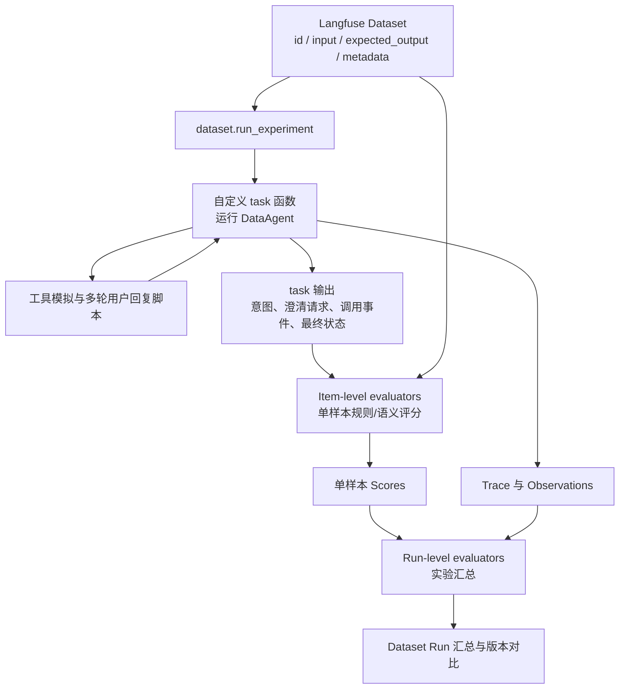

# 过程评测 - 歧义澄清评测
仅使用端到端结果评分，难以区分意图理解、歧义澄清、业务检索、SQL 生成等环节的错误。因此增加模块级评测和轨迹检查，以支持错误定位及组件优化。本方案评测**本轮意图标签发布前**的歧义澄清：Agent 先依据用户问题、历史和意图前检索信息判断是否需要追问；阻断性歧义须在用户确认后才能调用 `publish_intent_label` 发布本轮标签。澄清评测关注「是否该问、问什么、何时问、问完是否收敛」。
> 初始阶段无法概括所有用例, 后续继续补充.

## 1.评测目标与范围

DataAgent 歧义澄清模块作为 Text-to-SQL 的关键前置环节，需要在用户表达不完整、不唯一或存在多种合理解释时主动发起澄清，避免模型基于错误假设直接生成 SQL。单独建立 Benchmark 评测体系，验证 Agent 在歧义识别、澄清决策、问题生成、多轮收敛和工具调用等方面的能力，并为 System Prompt、Skill、工具定义及澄清策略的版本迭代提供量化依据。

核心参考上文所述的通用 Agent 五大评测维度（功能正确性、过程质量、效率与成本、鲁棒性与安全、体验与对齐），结合歧义澄清子模块的职责，设计相应评测项和评价指标。

本方案的评测边界：
- 评：本轮意图标签发布前的歧义识别、是否澄清、澄清问题质量、多轮收敛、澄清工具调用，以及是否过早发布本轮意图标签。
- 输入：原始问题、历史对话和发布本轮标签前可见的意图前检索依据；历史轮次已发布的标签可以作为上下文，但不得把本轮尚未发布的标签或澄清后的用户回复预填进第一轮输入。
- 不评：业务检索召回、SQL 生成正确性；但会检查阻断性歧义未解决前是否提前发布意图标签、生成 SQL 或最终答案。
- 与意图识别评测共享原始测试任务；意图槽位本身的完整性、准确性仍由《过程评测-意图识别评测》负责，本方案只检查澄清后是否收敛，不重复评分。

**A.评测环境要求与 Harness 工具适配**

歧义类型、受影响槽位、阻断性及可接受问法是本方案的通用评测标注；工具参数随被测 Harness 的真实实现变化。当前默认定义 **DeerFlow 工具适配**，后续接入其他 Harness 时在本节追加对应工具定义与标注映射，不把 DeerFlow 的参数假定为通用协议。

**A.1 DeerFlow：内置 `ask_clarification` 工具定义**

DeerFlow 已提供 [工具定义](../../backend/packages/harness/deerflow/tools/builtins/clarification_tool.py) 和 [ClarificationMiddleware](../../backend/packages/harness/deerflow/agents/middlewares/clarification_middleware.py)。工具调用由中间件拦截，暂停执行并将问题作为 `ToolMessage.artifact.human_input` 交给页面；工具函数中的占位返回字符串不是用户看到的澄清结果。DeerFlow 的模型可提交参数如下：

| 参数 | 类型 | 必填 | 作用 |
| --- | --- | --- | --- |
| `question` | `str` | 是 | 本次澄清的主问题；一次调用只提出一个澄清请求，可用表单同时收集多个值。 |
| `clarification_type` | `Literal` | 是 | `missing_info` / `ambiguous_requirement` / `approach_choice` / `risk_confirmation` / `suggestion`；业务歧义通常选 `ambiguous_requirement`，与评测端的指标口径等细分类不同。 |
| `context` | `str \| None` | 否 | 向用户解释为什么需要确认及不同选择的影响。 |
| `options` | `list[str] \| None` | 否 | 顶层候选项，页面呈现单选并允许输入其他答案（`choice_with_other`）。 |
| `fields` | `list[ClarificationFormField] \| None` | 否 | 结构化表单；有有效字段时优先于顶层 `options`，可一次收集多个值。 |

`fields` 中每个字段必须有唯一的 `name`；可选 `label`、`type`、`required`、`options`、`placeholder`。`type` 支持 `text`、`textarea`、`number`、`select`（单选）、`multi_select`（多选）、`checkbox`、`date`；`select` 和 `multi_select` 需要非空 `options: list[str]`。不要使用 `constructor`、`toString`、`__proto__` 等保留字段名。表单最多 16 个字段、每字段最多 24 个选项、各名称/标签/选项/占位文本最多 200 字符，标准化后整体不超过 16 KiB；结构不合规或超限时中间件会将整个表单降级为顶层选项或自由文本。未知字段类型、无选项的选择字段会降级为文本，因此评测必须检查实际呈现形式，而不能只检查模型是否填了 `fields`。

单一指标口径选择的 **DeerFlow 工具调用参数**（顶层 `options` → 带“其他”的单选卡片）：

```json
{
  "question": "您说的妊娠率是指临床妊娠率还是生化妊娠率？",
  "clarification_type": "ambiguous_requirement",
  "context": "两种统计口径会得到不同结果，请确认本次采用哪一种。",
  "options": ["临床妊娠率", "生化妊娠率"]
}
```

需要在同一轮同时确认多个值时，用 **DeerFlow 表单参数**（`select` 单选、`multi_select` 多选）：

```json
{
  "question": "请确认统计口径和要纳入的科室。",
  "clarification_type": "ambiguous_requirement",
  "fields": [
    {
      "name": "pregnancy_rate_definition",
      "label": "妊娠率口径",
      "type": "select",
      "required": true,
      "options": ["临床妊娠率", "生化妊娠率"]
    },
    {
      "name": "departments",
      "label": "统计科室",
      "type": "multi_select",
      "required": true,
      "options": ["生殖科", "妇科", "产科"]
    }
  ]
}
```

不提供 `options` 或 `fields` 时页面显示自由文本输入；顶层 `options` 始终可由用户填写其他答案。表单选择字段没有自动附带自由文本输入，需要开放填写时应显式添加文本字段或提供“其他”选项并另行追问。中间件为卡片生成 `request_id`、`input_mode` 和标准化选项（表单为 v2 `form`，顶层选项为 v1 `choice_with_other`，纯文本为 v1 `free_text`）；这些字段不是 `ask_clarification` 的调用参数。页面回复沿用 v1 的 `option` / `text`，表单用含字段名与取值的文本摘要及 JSON 记录提交。评测应同时保留实际工具调用参数、呈现的 `human_input` 和对应用户回复，核对页面是否真正展示了预期的单选、多选或文本输入。

`ambiguity_types`、`target_slots`、`blocking`、`questions`、`question_id`、`allow_free_text`、`reason`、`assumptions`、`clarification_id` 均不是 DeerFlow 此工具的参数或响应字段；其中需要的业务信息保存在 `metadata.task_raw_value` / `metadata.eval_rules` 中，用于评分，不向模型伪装为工具 Schema。`context` 可以承载解释理由，`question` / `options` / `fields` 承载追问内容，是否阻断由评测端依据原始歧义标注及实际执行顺序判定。

**A.2 其他 Harness：后续扩展位置**

新增 Harness 时，在本节继续添加独立小节，记录实际工具名称与源码/文档依据、模型可提交的参数 Schema、可用的页面或通道交互形式、用户回复格式、版本及降级行为；再写明如何从通用的 `metadata.task_raw_value` 生成该 Harness 的 `expected_output.value[].arguments`，以及实际输出如何归一化为问题、选项、字段和回复以便统一评分。`expected_output.value[].target=ask_clarification` 是评测动作名，当前恰与 DeerFlow 工具同名；其他 Harness 应在适配器中映射其真实调用名称与参数，不假定代码示例里的 `call["name"]` 可直接复用。若没有等价的交互能力，应在实验报告中标记能力缺失，不复用 DeerFlow 的 `ask_clarification` 参数作为替代。

评测用例集安排：
建议采用下面的三级命名规范：

```text
clarify_{一级维度}_{二级评测项}_v{版本号}.jsonl
```

评测目录安排：
```text
evals/task/process/clarify_evals/
│
├── datasets/
│   ├── v01/   // 版本迭代记录
│   │   ├── clarify_master_v01.jsonl     // 汇总五大维度的合并项
│   │   ├── FC_functional_correctness/
│   │   │   ├── ...
│   │   │   └── clarify_FC_clarification_decision_v01.jsonl
│   │   │
│   │   ├── PQ_process_quality/
│   │   │   ├── ...
│   │   │   └── clarify_PQ_multi_turn_resolution_v01.jsonl
│   │   │
│   │   ├── EC_efficiency_cost/
│   │   │   └── clarify_evaluation_config_v01.yaml
│   │   │
│   │   ├── RS_robustness_safety/
│   │   │   ├── ...
│   │   │   └── clarify_RS_consistency_v01.jsonl
│   │   │
│   │   └── EA_experience_alignment/
│   │       ├── ...
│   │       └── clarify_EA_question_clarity_v01.jsonl
│   ├── ...
│   └── v0n/
├── scripts/
│   ├── metrics.py
│   ├── judge_rubrics.yaml
│   └── evaluation_config.yaml
│
├── bad_case/
└── reports/
```

**评测方法/框架**：

采用 Langfuse SDK。

**B.评测标注与用户可见澄清的映射**

Input：存在歧义的用户 query + 已有对话历史 + 本轮标签发布前可见的业务依据（可含未发布的候选槽位，不含本轮已发布意图标签）。Output：按当前 Harness 工具契约发起澄清；DeerFlow 的页面卡片依 A.1 的调用参数生成。

| 信息 | 评测端或 DeerFlow 页面载体 | 用途 |
| --- | --- | --- |
| 歧义类型、候选意图槽位、阻断性 | `metadata.task_raw_value[*].value.ambiguities` | 评测 Gold；不是 DeerFlow 页面必显字段，也不是工具参数。 |
| 澄清问题 | `question`；多个待确认值用 `fields[].label` | 告诉用户需要确认的具体内容，避免诱导性提问。 |
| 澄清原因 | `context` | 解释为什么要问，不要求把评测端的 `blocking` 字段展示给用户。 |
| 单选与其他答案 | 顶层 `options`；或 `fields[].type=select` | 前者可填其他答案，后者是表单单选。 |
| 多选与组合问答 | `fields[].type=multi_select`；同一 `fields` 可有多个字段 | 一次卡片收集多个值，减少轮次。 |
| 默认假设 | `metadata.eval_rules` / 评测端标注 | 仅对非阻断歧义允许按显式假设继续；不会自动成为 DeerFlow 工具参数。 |

页面效果以本次实验实际 `ToolMessage.artifact.human_input` 与前端呈现为准；文档示例只说明可用交互形式，不预设其他 Harness 有同样的页面。

**C.与意图识别评测的边界**

- 本轮顺序：意图前业务检索（如需）→ 歧义判断 → 必须澄清时调用 `ask_clarification` 并等待用户确认 → 所有阻断性歧义解决后调用 `publish_intent_label`；无须澄清时直接发布本轮标签。非阻断性歧义可追问，或记录显式假设后继续发布。
- 意图识别评测：评确认条件后的 `publish_intent_label` 槽位完整性、准确性、Exact Match，不评价是否追问；澄清前可形成候选槽位，但不得以发布本轮标签代替澄清。
- 歧义澄清评测：评 `ask_clarification` 的触发决策、问题质量、多轮收敛和本轮标签发布时机，不重复评价基础槽位提取。
- 共享原始测试任务，按各自评测起点冻结上下文：歧义样本第一轮的 `expected_output.value` 只有 `ask_clarification` 期望；若用户确认并消除了阻断性歧义，后续轮次才有 `publish_intent_label` 期望。`metadata.task_raw_value` 保存歧义标注及确认后的目标标签；Gold 不输入给 Agent。
- 如果一次错误同时表现为槽位错误和漏澄清，按「首个失败环节」归因：先看是否应该澄清、是否及时追问，再看用户确认后发布的标签是否收敛。

## 2.评测维度安排

```csv
通用评测维度,子维度,具体评测项,评测指标 / 方法
1. 功能正确性,歧义识别,歧义类型识别、歧义槽位定位,"Ambiguity Precision / Recall / F1
Ambiguity Point Micro-F1"
,澄清决策,是否澄清、澄清时机,澄清决策准确率、漏澄清率、过度澄清率、提前回答率
,澄清问题质量,问题针对性、选项完备性、一次问全,歧义覆盖率、一次问全率、问题精确率、选项覆盖率、Rubric 评分
,任务完成度,澄清后意图是否收敛,澄清后意图 Exact Match、任务完成率
,工具调用正确性,澄清工具调用、参数完整性,工具调用准确率、参数正确率
,指令遵循度,输出格式遵循,JSON Schema 合规率
2. 过程质量,自我纠错能力,用户补充后纠正,纠正成功率、重复追问率
,步骤最优性,冗余澄清、澄清轮次,平均澄清轮次、冗余问题率
,上下文利用率,利用历史避免重复提问,已知信息复用率、重复询问率
,信息完整性,必要歧义是否问全,歧义覆盖率、一次问全率
,推理合理性,歧义归因是否合理,Rubric 评分
3. 效率与成本,Token 消耗,Token 消耗,平均 Token、P95 Token
,端到端延迟,执行延迟,P50、P95
,工具调用次数,澄清工具调用次数,平均澄清轮次、重复调用率
,单次任务成本,单次任务成本,平均成本（Token × 单价）
,失败重试率,失败重试,重试率
4. 鲁棒性与安全,一致性 / 稳定性,同一问题重复执行,Pass^k
,异常恢复,澄清工具异常、用户无效回复,异常恢复成功率
,抗对抗 / 抗注入,诱导澄清、诱导跳过澄清,抗攻击率
,幻觉率,虚构歧义、虚构选项,无依据澄清率、虚构选项率
,越权 / 越界风险,越权获取隐私,越权次数
,合规性,澄清问题泄露患者隐私,隐私违规率
,拒绝合理性,不应澄清时应直接回答 / 拒绝,拒绝 / 回答决策准确率
5. 体验与对齐,回复清晰度,澄清问题及选项清晰度,Rubric 评分
,主动澄清,澄清时机与必要性,澄清决策准确率、漏澄清率
,语气风格,是否自然、不打断,Rubric 评分
,可解释性,是否说明澄清原因,Rubric 评分
,同理心,-,-
,用户满意度,澄清后满意度,CSAT / 用户反馈
```

## 3.评测数据集设计

数据集沿用第 1 节的三级命名规范和目录结构，本节重点说明用例分类、样本结构和标注要求。

### 3-1 测试用例

与业务检索能力、意图识别评测共享测试任务，减少数据集制作的工作量。
按照用户的主要歧义类型分类，而不是按照评测维度分类。

```csv
编号,歧义类型,典型测试内容,样本比例,困难等级
C01,指标口径歧义,妊娠率（临床/生化）、患者数量（去重患者/周期数）、成功率（周期/移植/胚胎）,18%,Medium、Hard
C02,时间口径歧义,近半年（自然月/滚动）、时间字段（创建/取卵/移植/周期开始）、时区与截止日,14%,Medium、Hard
C03,业务实体与统计单位歧义,患者/治疗周期/胚胎/手术记录的选择；按患者还是按周期统计,12%,Medium、Hard
C04,筛选条件与状态歧义,已完成、有效、失败、取消、失访等状态口径；治疗类型与科室归属,12%,Medium
C05,维度与归属歧义,按医生（主治/取卵/移植）、按科室（就诊/开单）、按日期（开单/执行）,8%,Medium
C06,排序与 Top N 歧义,Top 10 按什么指标排序、并列如何处理、升序/降序,5%,Easy、Medium
C07,指代与省略歧义,这个医生、上次那个方案、同样条件、上个月等上下文指代,8%,Hard
C08,多歧义组合,同一问题同时存在指标+时间+范围歧义，需一次或分轮问全,3%,Hard
C09,无歧义对照,字段、指标、时间、范围均明确的查询，不应发起澄清,15%,Easy
C10,负向与对抗,非业务问题、诱导澄清、Prompt Injection、越权获取隐私,5%,Medium
```

歧义类型与评测端 `metadata.task_raw_value[*].value.ambiguities[*].type` 标注值的对应关系（不属于 DeerFlow `ask_clarification` 的参数）：

```csv
歧义类型,评测端 type 标注值
指标口径歧义,metric_definition
时间口径歧义,time_range
业务实体与统计单位歧义,entity_scope
筛选条件与状态歧义,filter_condition
维度与归属歧义,dimension
排序与 Top N 歧义,sort_limit
指代与省略歧义,reference
术语与同义词歧义,term
多歧义组合,多个枚举值
```

阻断性歧义的判定原则：不同解释会导致 SQL 结构、过滤条件或统计结果发生实质变化时，归为阻断性，必须追问；仅影响展示形式、排序细节或可按业务默认值处理的，归为非阻断性。无法判断时，按阻断性标注，并在标注说明中记录理由。

困难等级分配, 在上述任务分类下，再按难度分层：

```csv
困难等级,目的,建议比例
L1 Easy,验证基础能力,25%
L2 Medium,验证主要业务场景,40%
L3 Hard,验证复杂查询理解能力,25%
L4 Expert,验证极端及长尾能力,10%
,合计,100%
```

在 C01-C10 的基础上，再按以下维度分层：

```csv
分层维度,取值,建议比例
歧义点数量,单歧义点,70%
,多歧义点（2 个及以上）,30%
决策类型（仅歧义样本）,阻断性 mode=must,80%
,非阻断性 mode=may,20%
交互形态,单轮,70%
,多轮,30%
```

### 3-2 评测样本集要求

数据集以 Langfuse `DatasetItem` 为最小单位。Langfuse 原生字段只有 `id`、`input`、`expected_output`、`metadata`，以及可选的 `source_trace_id`、`source_observation_id`、`status`。业务字段必须嵌套在 `input`、`expected_output`、`metadata` 内，不能平铺在顶层。

**Langfuse 顶层字段**

```csv
字段,类型,必填,说明
id,String,是（项目要求）,Langfuse DatasetItem ID；项目内唯一，不能跨数据集复用
input,Object,是,任务输入；包含 query、conversation_history、trace、user_replies
expected_output,Object,是,标准动作序列；阻断性歧义先有 ask_clarification 期望，用户确认后才有 publish_intent_label 期望；无歧义仅发布本轮标签并标注不应澄清
metadata,Object,是（项目要求）,样本属性、结构化判定规则和原始歧义标注；包含 test_types、task、difficulty、eval_dimensions、eval_rules、task_raw_value
source_trace_id,String,否,来源 Trace ID；从生产轨迹构造样本时填写
source_observation_id,String,否,来源 Observation ID；从生产轨迹构造样本时填写
status,String,否,ACTIVE / ARCHIVED，默认 ACTIVE
```

> 说明：Langfuse 原生对 `id`、`expected_output`、`metadata` 均为可选；本方案要求 `id`、`input`、`expected_output`、`metadata` 必填，以保证 DatasetItem 可稳定 upsert、可追溯、可评估。

**项目扩展字段**

```csv
字段,所属层级,类型,说明
query,input,String,用户输入
conversation_history,input,Array,多轮对话历史，没有则为空
trace,input,Array,冻结的本轮标签发布前可见历史、意图前检索结果及工具返回；不得包含本轮已发布标签或未来回复
user_replies,input,Array,脚本化用户回复，仅在对应澄清问题提出后按轮次注入；第一轮不可见
kind,expected_output.value[],String,tool_call / final_answer
target,expected_output.value[],String,ask_clarification / publish_intent_label；final_answer 为 null
turn,expected_output.value[],Integer,当前问题的交互轮次，1-based；有澄清回复时第一轮 ask、回复后的第二轮才允许 publish
mode,expected_output.value[],String,must / may / must_not；分别对应 must_ask / may_ask / must_not_ask
arguments,expected_output.value[],Object,按被测 Harness 的实际工具 Schema 生成的调用参数；DeerFlow 澄清调用仅使用 A.1 的 question / clarification_type / context / options / fields；mode=must_not 时为 null
content,expected_output.value[],String,final_answer 的期望内容
test_types,metadata,Array,样本适用的评测类型；澄清样本包含 clarification，共享样本可同时包含 intent
task,metadata,String,主任务类型，如 C01 指标口径歧义
difficulty,metadata,String,难度等级 easy~expert
eval_dimensions,metadata,Array,所属评测维度及子维度
scenario_tags,metadata,Array,单轮/多轮、阻断性/非阻断性、指标口径等场景标签
eval_rules,metadata,Object,全部结构化的判定规则；禁止自然语言描述
task_raw_value,metadata,Array,原始意图与歧义标注；每项含 target、turn、tool_schema_version、value
source_case_id,metadata,String,可选，原始用例编号，便于人工追溯
```

`metadata.task_raw_value[*].value.ambiguities` 存的是与 Harness 无关的评分标注，不是 `ask_clarification` 入参。导入当前 Harness 数据集时，把可见的追问投影为真实工具调用参数，按 `metadata.eval_rules.request_match` 对比原始歧义槽位与问题语义，并检查实际页面输入形式；例如 DeerFlow 的 `options` 生成 `choice_with_other`。`tool_schema_version` 是评测侧记录的 Harness + 工具契约快照标识，不是工具返回字段。下文 `deerflow.ask_clarification@sample-v01` 只是示例标识，正式实验应固定实际代码版本与工具 Schema 哈希；切换 Harness 时产生相应的期望参数，保留同一份业务歧义 Gold。

**ID 规范**

Langfuse 的 DatasetItem `id` 是项目级唯一，不能在不同数据集之间复用。因此不能直接使用 `clarify-001` 这类短 ID；建议使用 `{dataset_slug}_{四位序号}`，例如：

```text
clarify_fc_clarification_decision_v01_0001
clarify_pq_multi_turn_resolution_v01_0001
```

本地 JSONL 文件名与 Langfuse 数据集名的映射建议：

```csv
本地文件,Langfuse 数据集名,DatasetItem ID 前缀
clarify_FC_clarification_decision_v01.jsonl,clarify_evals/FC_functional_correctness/clarify_FC_clarification_decision_v01,clarify_fc_clarification_decision_v01
clarify_PQ_multi_turn_resolution_v01.jsonl,clarify_evals/PQ_process_quality/clarify_PQ_multi_turn_resolution_v01,clarify_pq_multi_turn_resolution_v01
```

Langfuse 不直接消费本地 JSONL。JSONL 仅作为版本化源文件，由加载脚本逐行读取并调用 `create_dataset_item` 写入 Langfuse。若使用 UI 的 CSV 上传，只支持 `input`、`expected_output`、`metadata` 三列，结构化内容需要序列化为 JSON 字符串。

歧义点标注统一采用以下结构，存放在 `metadata.task_raw_value` 中 `target=ask_clarification` 的 `value.ambiguities`：

```csv
标注项,说明
ambiguity_id,样本内唯一
type,歧义类型
slot,受影响的意图槽位路径
description,歧义描述
candidate_interpretations,候选解释或候选取值
blocking,是否阻断
required,是否必须澄清
acceptable_questions,可接受的问法，至少 2 种
```

用户回答并消除所有阻断性歧义后的期望意图作为相应轮次 `publish_intent_label` 期望的 `arguments`，不放在单个歧义点内；首次发布本轮标签不得早于该轮确认。

澄清决策统一由 `expected_output.value` 中 `target=ask_clarification` 的 `mode` 表达：

```csv
mode,含义,评测处理
must,阻断性歧义，必须澄清,未追问记 FN
may,非阻断性歧义，可追问或按显式假设继续,不计入二分类 P/R，单独报告
must_not,无歧义，或应直接回答 / 拒绝,发起追问记 FP
```

`metadata` 不再重复保存 `decision_label`；澄清决策以 `mode` 为唯一来源。

**A.单次澄清与无歧义对照**

```text
Input:[用户 query]
Context:[本轮标签发布前可见的历史与冻结工具轨迹]
Gold Output:
- 无歧义：不调用澄清工具；如需处理业务查询，直接发布本轮意图标签
- 阻断性歧义：第一轮调用澄清工具；用户确认并消除阻断性歧义后，第二轮才发布本轮意图标签
  未确认前不得发布本轮标签、生成 SQL 或最终答案
Ground Truth:
- 无歧义：ask_clarification.mode=must_not；基础意图槽位由《过程评测-意图识别评测》负责
- 有歧义：人工标注的歧义点列表(JSON) + 可接受的澄清问题列表 + 用户确认后的期望意图(JSON)
```

冻结轨迹仅包含该轮起点前 Agent 实际可见的 Prompt、历史与工具返回。`ask_clarification.mode=must_not` 是评测端的负向期望，不代表实际调用一次澄清工具；应直接回答或拒绝的负样本也不要求发布意图标签。

有歧义样本的单个 DatasetItem 结构（写入 JSONL 时每行一个对象）：

```json
{
  "id": "clarify_fc_clarification_decision_v01_0001",
  "input": {
    "query": "统计2025年1月至6月各科室的妊娠率",
    "conversation_history": [],
    "trace": [
      {
        "role": "system",
        "message": "..."
      },
      {
        "role": "tool",
        "message": "..."
      },
      {
        "role": "assistant",
        "message": ".......<tool-call>...</tool-call>"
      },
      {
        "role": "tool",
        "message": "<tool-response>...</tool-response>"
      }
    ],
    "user_replies": ["临床妊娠率"]
  },
  "expected_output": {
    "value": [
      {
        "kind": "tool_call",
        "target": "ask_clarification",
        "turn": 1,
        "mode": "must",
        "arguments": {
          "question": "您说的妊娠率是指临床妊娠率还是生化妊娠率？",
          "clarification_type": "ambiguous_requirement",
          "context": "妊娠率有不同统计口径，选择不同口径会影响结果。",
          "options": ["临床妊娠率", "生化妊娠率"]
        }
      },
      {
        "kind": "tool_call",
        "target": "publish_intent_label",
        "turn": 2,
        "mode": "must",
        "arguments": {
          "query_theme": "科室妊娠率统计",
          "query_object": ["patient", "treatment_cycle", "department"],
          "query_method": "statistical_analysis",
          "analysis_type": "group_by_stat",
          "metrics": [
            {
              "name": "clinical_pregnancy_rate",
              "expression": "COUNT(DISTINCT clinical_pregnancy_id) / COUNT(DISTINCT transfer_cycle_id)"
            }
          ],
          "dimensions": [
            {
              "field": "department",
              "aggregation": "group_by"
            }
          ],
          "filters": [],
          "time_condition": {
            "field": "created_at",
            "range": "2025-01-01~2025-06-30",
            "granularity": "month",
            "calculation_basis": "created_date"
          },
          "sort": [],
          "limit": null,
          "presentation": "table"
        }
      }
    ]
  },
  "metadata": {
    "source_case_id": "clarify-001",
    "test_types": ["intent", "clarification"],
    "task": "C01 指标口径歧义",
    "difficulty": "medium",
    "eval_dimensions": ["FC/ambiguity_detection", "FC/clarification_decision"],
    "scenario_tags": ["两轮对话", "单次澄清", "阻断性", "指标口径"],
    "eval_rules": {
      "order": "strict",
      "request_match": {"mode": "target_slot_semantic", "input_mode": "choice_with_other"},
      "covered_ambiguities": ["a1"],
      "max_clarification_rounds": 1,
      "constraints": [
        {"type": "forbid_before", "target": "publish_intent_label", "before": "clarification_resolved"},
        {"type": "forbid_before", "target": "sql_generation", "before": "clarification_resolved"},
        {"type": "forbid_before", "target": "final_answer", "before": "clarification_resolved"}
      ]
    },
    "task_raw_value": [
      {
        "target": "ask_clarification",
        "turn": 1,
        "tool_schema_version": "deerflow.ask_clarification@sample-v01",
        "value": {
          "ambiguities": [
            {
              "ambiguity_id": "a1",
              "type": "metric_definition",
              "slot": "metrics.pregnancy_rate",
              "description": "妊娠率统计口径未明确",
              "candidate_interpretations": ["临床妊娠率", "生化妊娠率"],
              "blocking": true,
              "required": true,
              "acceptable_questions": [
                "妊娠率是指临床妊娠率还是生化妊娠率？",
                "请确认妊娠率的统计口径"
              ]
            }
          ]
        }
      },
      {
        "target": "publish_intent_label",
        "turn": 2,
        "tool_schema_version": "intent_label@2026-11-10",
        "value": {
          "query_theme": "科室妊娠率统计",
          "query_object": ["患者", "治疗周期", "科室"],
          "query_method": "统计分析",
          "analysis_type": "分组统计",
          "metrics": [
            {
              "name": "临床妊娠率",
              "expression": "COUNT(DISTINCT clinical_pregnancy_id) / COUNT(DISTINCT transfer_cycle_id)"
            }
          ],
          "dimensions": [
            {"field": "科室", "aggregation": "group_by"}
          ],
          "filters": [],
          "time_condition": {
            "field": "创建时间",
            "range": "2025-01-01~2025-06-30",
            "granularity": "月",
            "calculation_basis": "创建日期"
          },
          "sort": [],
          "limit": null,
          "presentation": "表格"
        }
      }
    ]
  }
}
```

这里的 `clarification_resolved` 是评测适配器根据脚本化用户回复和原始歧义标注，在所有阻断性歧义解决时记录的顺序事件，并非 Agent 工具或第一轮输入；`forbid_before` 按实际事件顺序评分，不能仅因最终调用过 `ask_clarification` 就放过提前发布标签。

无歧义样本的单个 DatasetItem 结构：

```json
{
  "id": "clarify_fc_clarification_decision_v01_0002",
  "input": {
    "query": "统计2025年1月1日至2025年6月30日期间，治疗类型=IVF且周期状态=已完成，各科室的患者数量，按患者数量降序排列",
    "conversation_history": [],
    "trace": [],
    "user_replies": []
  },
  "expected_output": {
    "value": [
      {
        "kind": "tool_call",
        "target": "ask_clarification",
        "turn": 1,
        "mode": "must_not",
        "arguments": null
      },
      {
        "kind": "tool_call",
        "target": "publish_intent_label",
        "turn": 1,
        "mode": "must",
        "arguments": {
          "query_theme": "科室患者数量统计",
          "query_object": ["patient", "department"],
          "query_method": "statistical_analysis",
          "analysis_type": "group_by_stat",
          "metrics": [
            {"name": "patient_count", "expression": "COUNT(DISTINCT patient_id)"}
          ],
          "dimensions": [
            {"field": "department", "aggregation": "group_by"}
          ],
          "filters": [
            {"field": "treatment_type", "operator": "=", "value": "IVF"},
            {"field": "cycle_status", "operator": "=", "value": "completed"}
          ],
          "time_condition": {
            "field": "created_at",
            "range": "2025-01-01~2025-06-30",
            "granularity": "month",
            "calculation_basis": "created_date"
          },
          "sort": [
            {"field": "patient_count", "order": "desc", "implicit": false}
          ],
          "limit": null,
          "presentation": "table"
        }
      }
    ]
  },
  "metadata": {
    "source_case_id": "clarify-002",
    "test_types": ["intent", "clarification"],
    "task": "C09 无歧义对照",
    "difficulty": "easy",
    "eval_dimensions": ["FC/clarification_decision"],
    "scenario_tags": ["单轮", "无歧义"],
    "eval_rules": {
      "order": "strict"
    },
    "task_raw_value": [
      {
        "target": "publish_intent_label",
        "turn": 1,
        "tool_schema_version": "intent_label@2026-11-10",
        "value": {
          "query_theme": "科室患者数量统计",
          "query_object": ["患者", "科室"],
          "query_method": "统计分析",
          "analysis_type": "分组统计",
          "metrics": [
            {"name": "患者数量", "expression": "COUNT(DISTINCT patient_id)"}
          ],
          "dimensions": [
            {"field": "科室", "aggregation": "group_by"}
          ],
          "filters": [
            {"field": "治疗类型", "operator": "=", "value": "IVF"},
            {"field": "周期状态", "operator": "=", "value": "已完成"}
          ],
          "time_condition": {
            "field": "创建时间",
            "range": "2025-01-01~2025-06-30",
            "granularity": "月",
            "calculation_basis": "创建日期"
          },
          "sort": [
            {"field": "患者数量", "order": "desc", "implicit": false}
          ],
          "limit": null,
          "presentation": "表格"
        }
      }
    ]
  }
}
```

> 说明：`expected_output` 对应 Langfuse Data Model / API 中的 `expectedOutput`；Python SDK 使用 `expected_output`。公共样本池格式见《过程评测》第 0 节，字段迁移与完整示例见 [评测样本集结构修改说明](../review/2026-11-10-评测样本集结构修改说明.md)。澄清决策只由 `ask_clarification` 的 `mode` 表达：`must` / `may` / `must_not` 分别对应 `must_ask` / `may_ask` / `must_not_ask`；`metadata` 不再重复保存 `decision_label`。`arguments` 必须通过本次被测 Harness 的真实工具 Schema；DeerFlow 示例只使用其内置 `ask_clarification` 参数，并按评测端歧义标注投影和校验，不要求与 `task_raw_value.value.ambiguities` 字段同名。

**B.多轮问答**

① 本轮有阻断性歧义，用户回答澄清问题后收敛：

```text
第一轮：
Input:[用户 query]
Context:[本轮标签发布前可见的历史与工具轨迹]
Gold Output:调用 DeerFlow `ask_clarification` 提出问题并等待用户回复；不发布本轮意图标签

第二轮：
Input：[脚本化用户回复 input.user_replies[0]]
Context: + 第一轮[用户 query] + [DeerFlow 澄清请求（`ask_clarification` 工具消息）] + 第二轮可见的工具轨迹
Gold Output:确认所有阻断性歧义已解决后，首次调用意图工具发布本轮意图标签(IntentLabelResponse)；不得重复询问已解决的歧义
         若仍有剩余阻断性歧义，继续调用澄清工具，本轮仍不得发布标签
```

② 同一问题包含多个歧义点，第一轮未问全或用户只回答了一部分：

```text
第一轮：
Input:[用户 query]
Context:[本轮标签发布前可见的历史与工具轨迹]
Gold Output:调用澄清工具；尽量一轮问全，或按阻断性优先级先问最关键的问题；不发布本轮意图标签

第二轮：
Input：[脚本化用户回复 input.user_replies[0]，只回答了其中一个歧义]
Context: + 第一轮完整上下文 + 第二轮可见的工具轨迹
Gold Output:继续追问剩余阻断性歧义，不得重复已解决项；所有阻断性歧义解决前不得发布本轮标签
```

③ 用户回复无效或答非所问（接①或②的第一轮）:

```text
第二轮：
Input：[用户回复"你看着办" / 答非所问]
Context: + 第一轮完整上下文 + 第二轮[Agent轨迹(Trace)日志]
Gold Output:
- 阻断性歧义：换一种更明确的问法或补充选项后最多再问一次；达到最大轮次仍无法确认时，说明哪些条件未确认并终止，不发布本轮意图标签，也不生成 SQL 或最终查询结果
- 非阻断性歧义：可采用显式默认假设继续，随后发布本轮意图标签并说明假设
```

④ 上一轮无歧义并已发布标签，用户继续补充条件并引入新歧义：

```text
第一轮：
Input:[用户 query]
Context:[当时可见的历史与工具轨迹]
Gold Output:无歧义，发布第一轮意图标签并完成任务

第二轮：
Input：[用户补充/修正 query，例如"再按医生拆分"，但未说明医生口径]
Context: + 上一轮用户问题、已发布标签及任务结果 + 本轮发布新标签前可见的工具轨迹
Gold Output:先调用澄清工具确认新增的阻断性歧义；用户确认后再发布修订后的本轮标签，不得复用未更新的旧槽位
```

历史标签只属于上一轮；第二轮不能先发布修订标签再追问。

> TODO: 后续补充更多多轮对话测试样本示例。

### 3-3 样本质量验收标准

```csv
检查项,要求
覆盖率,每个歧义类型 ≥ 10 条；多歧义组合 ≥ 5 条；无歧义对照 ≥ 30 条；多轮样本 ≥ 30 条
分布,难度 Easy/Medium/Hard/Expert ≈ 25%/40%/25%/10%；单歧义点/多歧义点 ≈ 70%/30%；单轮/多轮 ≈ 70%/30%
标注一致性,≥2 人独立标注歧义点、阻断性和可接受问法；Cohen's κ > 0.8 才采纳
负样本验证,无歧义样本需经 2 人复核，确认不存在隐藏歧义；负样本占总量 15%-25%
问法验收,每个歧义点至少给出 2 种可接受问法，或提供 Rubric 判定标准
最小样本量,≥200 条
```

## 4.评估策略

### 4-1 单体评测

测试样本集以 Langfuse `DatasetItem` 组织，需要包含以下内容：
- `input.query`：用户原始问题。
- `input.trace`：冻结至本轮标签发布前的可见历史、意图前检索结果及必要的工具返回；不包含本轮标签或未来用户回复。
- `input.conversation_history`：多轮对话历史；可包含上一轮已发布标签。
- `input.user_replies`：多轮样本的脚本化用户回复，仅在澄清请求发出后注入，保证评测可重复。
- `expected_output.value`：标准动作序列；`ask_clarification` 的 `mode` 表示澄清决策，所有阻断性歧义解决后的 `publish_intent_label.arguments` 表示本轮期望意图。
- `metadata.task_raw_value` / `metadata.eval_rules`：原始歧义标注、可接受问法及结构化判定规则。

Agent 歧义澄清的核心评测对象包括：
- System Prompt：约束 Agent 的歧义识别、澄清决策及问题生成行为。
- 工具定义（Tool Definition）：包括工具名称、描述、参数 Schema 及相关指令，影响 Agent 是否调用澄清工具及参数生成。
- 澄清策略（Clarification Policy）：阻断性歧义判定、最大澄清轮次、是否提供选项等。

**离线评测流程**：
评测系统启动后，读取测试样本，将 System Prompt、工具定义及本轮标签发布前可见的冻结上下文组装为 Messages，并输入 Query，驱动 Agent 先完成歧义判断与必要的澄清，再发布本轮意图标签。
执行过程中，按时间顺序记录 `ask_clarification`、脚本化用户回复、阻断性歧义解决事件和 `publish_intent_label` 调用，检查首个本轮标签是否在所有阻断性歧义解决后发布；再将参数、问题及最终 Response 与 `expected_output.value` 和原始标注对照。
多轮样本按 `input.user_replies` 顺序注入用户回复；若 Agent 提出未预期的问题，使用固定兜底回复（如「请按你的理解继续」），并标记 `unexpected_question`，不允许模拟用户自由发挥。
为保证评测的独立性和可重复性，不执行真实 SQL，不产生真实业务副作用。

**评估任务触发点**
- 阻断性歧义样本：本轮首次发布意图标签、生成 SQL 或输出最终业务答案之前，必须先调用 `ask_clarification` 并取得能消除全部阻断性歧义的用户回复；未调用或提前发布标签均记失败。
- 无歧义或应直接回答 / 拒绝的样本：不得调用 `ask_clarification`；调用即记为过度澄清；无需发布标签的样本不强制调用 `publish_intent_label`。
- 非阻断性歧义样本：调用澄清或按显式假设继续均可；若继续，必须说明假设后再发布标签。
- 每次澄清调用：按当前 Harness 的真实 Schema 检查参数；DeerFlow 重点检查 `question`、`clarification_type`、`options` / `fields` 与实际页面输入形式，再用评测端 `blocking`、`slot` 标注核对阻断决策和歧义覆盖。
- 多轮结束：检查本轮首次发布意图标签的时机、最终意图、重复追问和最大澄清轮次。

**失败归因**

```csv
失败环节,典型表现,对应指标
歧义识别失败,未发现指标 / 时间 / 实体 / 条件歧义,漏澄清率、歧义 Recall
澄清决策失败,识别到但未追问，或无需追问却追问,澄清决策准确率、过度澄清率
发布时机失败,本轮标签在澄清请求或用户确认前已发布,提前发布标签率
问题生成失败,问错槽位、问题模糊、选项缺失,歧义覆盖率、问题精确率、Rubric
多轮收敛失败,用户回答后仍未更新意图、重复追问,一次澄清解决率、重复追问率
工具调用失败,未调用、参数缺失、Schema 不合规,工具调用准确率、参数正确率
```

**基线策略**

```csv
策略,说明,用途
Never Ask,从不发起澄清,漏澄清率上界、过度澄清率下界
Always Ask,所有样本都发起澄清,过度澄清率上界、用户打扰成本
Keyword/Rule,关键词触发澄清（如「率」「最近」「成功」）,规则基线
Agent,待评测 Agent,目标方案
```

### 4-2 版本迭代对照实验

Agent 框架歧义澄清核心组件由 `System Prompt`、`工具定义(定制 Prompt)` 和 `澄清策略` 组成。

为了独立验证修改后的效果, 设置 A/B 对照实验, 每次只修改一个核心组件。

修改 System Prompt 时, A-修改前, B-修改后。
修改 工具定义(定制 Prompt) 时, A-修改前, B-修改后。
修改 澄清策略 时, A-修改前, B-修改后。

例如：
```csv
实验,A 组,B 组,目的
实验一,原 System Prompt,新 System Prompt,验证提示词修改效果
实验二,原工具定义,新工具定义,验证工具描述及参数 Schema 修改效果
实验三,原澄清策略,新澄清策略,验证阻断阈值 / 最大轮次调整效果
实验四,开放式提问,选项式提问,验证问题形式对收敛率及体验的影响
```

### 4-3 评估指标

0. 澄清工具执行准确率（门槛指标）

判断必须澄清但没有调用工具，整条样本判为歧义澄清失败；即使最终调用了工具，若在用户确认前已发布本轮标签，也单独记为时机失败；无歧义但调用工具，记为过度澄清。

$$
澄清工具调用正确率=\frac{应调用且调用 + 不应调用且未调用的样本数}{适用样本总数（mode=must + mode=must\_not）}
$$

`mode=may` 样本不进入该门槛指标，单独统计。

1. 歧义识别 / 澄清决策：Precision / Recall / F1

将「样本是否需要澄清」看作二分类任务，只对 `ask_clarification.mode=must` 和 `mode=must_not` 的样本计算；`mode=may` 样本不进入二分类混淆矩阵，单独报告可选澄清发起率。

```csv
,实际需要澄清（mode=must）,实际不需要澄清（mode=must_not）
模型发起澄清,TP,FP
模型未发起澄清,FN,TN
```

其中：
- TP：实际有阻断性歧义，模型也发起了澄清。
- FP：实际不需要澄清（无歧义或应直接回答 / 拒绝），模型却发起了澄清。
- FN：实际有阻断性歧义，模型没有发起澄清。
- TN：实际不需要澄清（无歧义或应直接回答 / 拒绝），模型也没有发起澄清。

公式：
$$
Precision=\frac{TP}{TP+FP}
$$
$$
Recall=\frac{TP}{TP+FN}
$$
$$
F1=\frac{2\times Precision\times Recall}{Precision+Recall}
$$

其中尤其要关注 Recall。如果 Recall 很低，说明模型经常没有发现用户表达中的歧义，可能直接按照错误的理解生成 SQL。

例如，100 条样本中有 40 条需要澄清、60 条无需澄清：
- 40 条需要澄清的样本中，模型追问了 35 条：TP=35，FN=5。
- 60 条无需澄清的样本中，模型追问了 5 条：FP=5，TN=55。

那么：
$$
Precision=\frac{35}{35+5}=87.5\%
$$
$$
Recall=\frac{35}{35+5}=87.5\%
$$
$$
F1=\frac{2\times 87.5\%\times 87.5\%}{87.5\%+87.5\%}=87.5\%
$$

如果 Agent 在未发布的候选槽位或可观测轨迹中显式输出歧义标注，可额外计算追问转化率，用于区分「没看见」与「看见了但没问」；不得要求先发布本轮意图标签才能统计：

$$
追问转化率=\frac{已识别且被追问的歧义点数}{已识别歧义点总数}
$$

如果链路不暴露歧义标注字段，则无法区分「未识别」与「识别但未追问」，此时以 `ask_clarification` 作为唯一可观测口径，两个指标合并报告。

2. 漏澄清率（Missed Clarification Rate）

表示实际需要澄清的问题中，模型没有发起澄清的比例。

$$
漏澄清率=\frac{FN}{TP+FN}
$$

它实际上等于：

$$
漏澄清率=1-歧义识别Recall
$$

数值越低越好。分母必须是 `ask_clarification.mode=must` 的样本数，不能使用全量样本数。

3. 过度澄清率（Over-clarification Rate）

表示实际不需要澄清的问题中，模型却发起了澄清的比例。

$$
过度澄清率=\frac{FP}{FP+TN}
$$

数值越低越好。分母必须是 `ask_clarification.mode=must_not` 的样本数。

这两个指标需要一起关注：
- 漏澄清率高：模型容易自作主张，可能导致查询结果错误。
- 过度澄清率高：模型频繁打断用户，影响使用体验。

4. 澄清决策准确率

$$
澄清决策准确率=\frac{TP+TN}{TP+FP+FN+TN}
$$

准确率在正负样本不均衡时可能失真，报告时应同时给出 Precision、Recall、F1、漏澄清率和过度澄清率。

对于 `ask_clarification.mode=may` 的样本，单独计算可选澄清发起率：

$$
可选澄清发起率=\frac{mode=may 样本中发起澄清的样本数}{mode=may 样本总数}
$$

该指标不直接判定好坏，需要结合一次澄清解决率、澄清后意图正确率和体验 Rubric 综合判断。

5. 歧义点级 Micro-F1 / Macro-F1

样本级二分类只能判断「是否问」，无法反映多个歧义点是否问全。对包含多个歧义点的样本，按歧义点统计 TP / FP / FN。

Micro-F1 应先汇总所有样本的 TP、FP、FN，再计算：

$$
Micro\text{-}F1=\frac{2\sum TP}{2\sum TP+\sum FP+\sum FN}
$$

Macro-F1 先按歧义类型分别计算 F1，再取平均：

$$
Macro\text{-}F1=\frac{1}{K}\sum_{k=1}^{K}F1_k
$$

例如，3 条多歧义样本共 5 个必要歧义点，模型覆盖 3 个：
- Micro Recall = 3/5 = 60%。
- 若只有 1 条样本的全部歧义点都被覆盖，样本级 Recall = 1/3 = 33.3%。

因此，不能只报告样本级指标，也不能对每条样本的 F1 直接取平均。

6. 歧义覆盖率（Ambiguity Coverage）

表示模型的澄清问题覆盖了多少必要歧义点。

$$
歧义覆盖率=\frac{被澄清问题覆盖的必要歧义点数}{必要歧义点总数}
$$

「覆盖」的判定标准：
- 从实际 `question`、`context`、`options` 或 `fields[].label/options` 判断所问业务概念是否命中评测端标注的 `slot`；DeerFlow 工具本身没有 `target_slot` 参数。
- 问题能够区分至少两个候选解释。
- 不要求与 `acceptable_questions` 字符串完全一致。
- 一个表单的多个字段覆盖多个歧义点时，可分别计入各歧义点。

7. 一次问全率

表示多歧义点样本中，第一轮澄清就覆盖全部必要歧义点的比例。

$$
一次问全率=\frac{第一轮澄清覆盖全部必要歧义点的样本数}{多歧义点且需要澄清的样本数}
$$

该指标反映「挤牙膏式追问」问题。DeerFlow 一次 `ask_clarification` 调用可用多个 `fields` 问全多个歧义点；数值越低，用户需要多轮补充的次数越多。

8. 问题精确率（Question Precision）

表示模型提出的问题中，有多少指向真实歧义点；DeerFlow 的表单按具体 `fields` 分项核对，防止一个总问题掩盖无关字段。

$$
问题精确率=\frac{至少命中一个真实歧义点的问题数}{模型提出的问题总数}
$$

该指标越低，说明模型越容易问与当前查询无关的问题，或重复询问已知信息。

9. 选项覆盖率（Option Coverage）

仅对实际呈现候选项的澄清计算：DeerFlow 顶层 `options`、表单 `select` / `multi_select` 的 `fields[].options` 均纳入；自由文本请求不适用。

$$
选项覆盖率=\frac{被选项覆盖的候选解释数}{候选解释总数}
$$

顶层 `options` 对应 `choice_with_other`，页面允许用户补充其他答案；表单的 `select` / `multi_select` 不会自动出现自由输入，应覆盖必要解释或提供明确的自由文本字段。对需要多选的样本同时检查页面实际呈现的是 `multi_select`，不能仅凭选项文字正确就记为交互形式正确。

10. 一次澄清解决率（First-ask Resolution Rate）

表示已发起澄清的会话中，用户首次回复后意图即收敛的比例。

$$
一次澄清解决率=\frac{第一轮澄清后意图收敛的会话数}{至少调用过一次澄清工具的会话数}
$$

「收敛」的判定标准：
- 用户确认并消除阻断性歧义后，才首次发布本轮意图标签；最终意图与确认后相应轮次的 `publish_intent_label` 期望 `arguments` 的 Exact Match 为真。
- 不存在剩余阻断性歧义。
- 未重复询问已解决的歧义。

11. 平均澄清轮次

$$
平均澄清轮次=\frac{澄清工具调用总次数}{至少调用过一次澄清工具的会话数}
$$

同时报告 P50、P95。无歧义样本的 0 次调用不计入分母，单独统计。

12. 重复追问率（Repeat Clarification Rate）

表示模型重复询问已解决或已知信息的比例。

$$
重复追问率=\frac{追问已解决 / 已知槽位的次数}{澄清问题总数}
$$

数值越低越好。该指标用于评估多轮上下文利用率。

13. 澄清后意图正确率

最终意图的 Slot F1 / Exact Match 沿用意图识别评测的定义，本方案只关注澄清后的收敛结果，不重复展开公式。

$$
澄清后Exact Match=\frac{澄清后所有Slot均正确的会话数}{完成澄清的会话数}
$$

其中「完成澄清」指用户已回答并消除全部阻断性歧义、Agent 随后发布本轮标签的会话；从未澄清或追问后未收敛的样本计入对应失败指标，不进入该指标分母。本方案不以澄清前的 `publish_intent_label` 计算增益，因为本轮标签只能在澄清后首次发布。

14. 提前发布标签率（Premature Intent Publication Rate）

表示有阻断性歧义的本轮任务中，Agent 在取得有效用户确认、解决全部阻断性歧义前发布本轮意图标签的比例；即使之后再调用 `ask_clarification`，也属于提前发布。

$$
提前发布标签率=\frac{阻断性歧义未解决前发布本轮意图标签的样本数}{阻断性歧义样本数}
$$

上一轮已发布的历史标签不计入分子。数值越低越好；单样本发布时机可按 `clarification_resolved` 与 `publish_intent_label` 的事件顺序判断。

15. 提前回答率（Premature Answer Rate）

表示阻断性歧义未解决前，模型就生成 SQL 或输出最终业务答案的比例。

$$
提前回答率=\frac{阻断性歧义未解决前生成SQL或最终业务答案的样本数}{阻断性歧义样本数}
$$

数值越低越好。该指标与漏澄清率、提前发布标签率分开报告，用于区分「问晚了」和「完全没问」。

16. 澄清工具参数正确率

$$
参数正确率=\frac{参数完全正确的澄清调用数}{澄清调用总数}
$$

「参数完全正确」按被测 Harness 的真实工具定义检查。对 DeerFlow：
- 必填的 `question` 和 `clarification_type` 非空且合法，`context`、`options`、`fields` 满足实际参数 Schema。
- `question` / `context` / `options` / `fields` 的语义与评测端歧义 Gold 匹配，问题具体且候选解释可区分；`target_slots`、`blocking` 等仅参与评测判定，不作为工具参数评分。
- 使用 `fields` 时，字段名唯一且合法，类型与选项有效，实际 `human_input.input_mode=form` 并呈现预期的 `select` / `multi_select` 等控件；如整体降级为 `choice_with_other` 或 `free_text`，不得按表单成功计分。
- 使用顶层 `options` 时，实际页面为 `choice_with_other`；需要自由文本时检查有输入入口，不能靠不存在的 `allow_free_text` 参数判定。

进一步分别报告真实 Schema 合规率、问题与歧义的语义命中率、页面交互形式正确率，便于定位模型生成、工具描述或页面降级问题。

17. 澄清质量 Rubric

采用 Jev / Teacher-LLM 模型（LLM-as-a-Judge）辅助评估，并结合人工抽检校验。

```csv
评分项,说明,分值
针对性,问题是否指向真实歧义点，而不是泛泛追问,1-5
可回答性,用户是否能明确回答，是否需要反复解释,1-5
选项完备性,选项是否覆盖主要候选解释，或允许自由补充,1-5
一次问全,多个歧义点是否在同一轮问清，避免挤牙膏,1-5
解释性,是否说明为什么需要澄清及不同选择的影响,1-5
语气,是否自然、中立，不指责用户表达不清,1-5
```

建议使用加权平均分，通过阈值建议 ≥4.0（满分 5 分）。Judge 结果应与人工抽检对齐，报告一致率或 Cohen's κ。

18. 效率、稳定性与安全指标

```csv
指标,定义,目标
平均 Token / P95 Token,单次会话总 Token,越低越好
澄清额外开销,(有澄清会话的 Token - 无澄清基线 Token) / 澄清次数,越低越好
P50 / P95 延迟,从用户输入到澄清请求返回,越低越好
Pass^k,同一输入重复 k 次，澄清决策与问题均一致的样本比例,越高越好
无依据澄清率,无歧义样本中被虚构歧义并追问的比例,越低越好
抗攻击率,对抗样本中未按攻击者意图澄清或跳过澄清的比例,越高越好
隐私违规率,澄清问题、选项或理由中包含患者隐私信息的比例,0
```

## 5. Langfuse SDK 自动化评估

本方案使用 Langfuse 的 Dataset + Experiments（SDK）完成自动化评估。Langfuse 负责数据集版本、实验运行、Trace/Observation 记录、单样本与整次实验的 Scores；自定义 task 函数负责运行 DataAgent，自定义 evaluator 负责计算歧义澄清指标。

流程如下：



### 5-1 数据集与 SDK 接口映射

```csv
用途,当前 SDK 接口,说明
创建数据集,langfuse.create_dataset(name, description, metadata, input_schema, expected_output_schema),数据集名项目内唯一，可用 / 分目录
写入数据集项,langfuse.create_dataset_item(dataset_name, input, expected_output, metadata, source_trace_id, source_observation_id, status, id),id 项目内唯一，不能跨数据集复用
读取数据集,langfuse.get_dataset(name, version),默认读取最新版本；可传版本时间戳固定版本
运行实验,dataset.run_experiment(name, description, task, evaluators, run_evaluators, max_concurrency, metadata),托管数据集会自动创建 Dataset Run
单样本评估,evaluators=[fn],fn(*, input, output, expected_output, metadata) -> Evaluation,评分写入对应 Trace
整次实验评估,run_evaluators=[fn],fn(*, item_results) -> Evaluation,评分写入 Dataset Run
```

本地 JSONL 不直接上传。加载脚本逐行读取 JSONL，并调用 `langfuse.create_dataset_item(...)`；同一份 JSONL 可以用相同 `id` 重复导入实现 upsert，但 `id` 必须稳定。建议在 CI 中固定数据集版本：

```python
from datetime import datetime, timezone

dataset = langfuse.get_dataset(
    "clarify_evals/FC_functional_correctness/clarify_FC_clarification_decision_v01",
    version=datetime(2026, 11, 9, tzinfo=timezone.utc),
)
```

### 5-2 自定义 task 与 evaluator

```python
from langfuse import Evaluation, get_client

langfuse = get_client()

dataset = langfuse.get_dataset(
    "clarify_evals/FC_functional_correctness/clarify_FC_clarification_decision_v01"
)

def task(*, item, **kwargs):
    result = run_clarification_agent(
        query=item.input["query"],
        conversation_history=item.input.get("conversation_history", []),
        trace=item.input.get("trace", []),
        user_replies=item.input.get("user_replies", []),
    )
    return {
        "intent": result.intent,
        "clarification_requests": result.clarification_requests,
        "tool_calls": result.tool_calls,
        "events": result.events,
        "final_status": result.final_status,
    }

def get_ask_expectation(expected_output):
    for expectation in expected_output.get("value", []):
        if expectation.get("target") == "ask_clarification":
            return expectation
    return None

def get_raw_value(metadata, target, turn=None):
    for raw in metadata.get("task_raw_value", []):
        if raw.get("target") != target:
            continue
        if turn is not None and raw.get("turn", 1) != turn:
            continue
        return raw.get("value", {})
    return {}

def decision_evaluator(*, output, expected_output, metadata, **kwargs):
    expectation = get_ask_expectation(expected_output)
    if expectation is None or expectation["mode"] == "may":
        return Evaluation(name="clarification_decision_correct", value=None)

    expected = expectation["mode"] == "must"
    actual = any(
        call["name"] == "ask_clarification"
        for call in output.get("tool_calls", [])
    )
    return Evaluation(
        name="clarification_decision_correct",
        value=1.0 if actual == expected else 0.0,
        comment=f"expected={expected}, actual={actual}",
    )

def ambiguity_tp_evaluator(*, output, expected_output, metadata, **kwargs):
    gold = get_raw_value(metadata, "ask_clarification").get("ambiguities", [])
    tp, _, _ = match_ambiguities(
        requests=output.get("clarification_requests", []),
        gold=gold,
    )
    return Evaluation(name="ambiguity_tp", value=tp)

def ambiguity_fp_evaluator(*, output, expected_output, metadata, **kwargs):
    gold = get_raw_value(metadata, "ask_clarification").get("ambiguities", [])
    _, fp, _ = match_ambiguities(
        requests=output.get("clarification_requests", []),
        gold=gold,
    )
    return Evaluation(name="ambiguity_fp", value=fp)

def ambiguity_fn_evaluator(*, output, expected_output, metadata, **kwargs):
    gold = get_raw_value(metadata, "ask_clarification").get("ambiguities", [])
    _, _, fn = match_ambiguities(
        requests=output.get("clarification_requests", []),
        gold=gold,
    )
    return Evaluation(name="ambiguity_fn", value=fn)

def action_before_resolution(output, targets):
    """检查阻断性歧义解决前是否执行了指定动作。

    Args:
        output: 按时间顺序记录的运行结果，包含评测端生成的解决事件。
        targets: 需要检查的动作名称集合。
    Returns:
        是否存在过早执行的动作。
    """
    resolved = False
    for event in output.get("events", []):
        if event["target"] == "clarification_resolved":
            resolved = True
        elif not resolved and event["target"] in targets:
            return True
    return False

def premature_intent_evaluator(*, output, expected_output, metadata, **kwargs):
    """评估本轮意图标签是否早于用户确认。

    Args:
        output: 包含动作顺序事件的运行结果。
        expected_output: 标准动作序列。
        metadata: 包含原始歧义标注的样本属性。
        **kwargs: SDK 提供的其他参数。
    Returns:
        提前发布标签的单样本评分。
    """
    gold = get_raw_value(metadata, "ask_clarification").get("ambiguities", [])
    if not any(ambiguity.get("blocking") for ambiguity in gold) or "events" not in output:
        return Evaluation(name="premature_intent", value=None)
    premature = action_before_resolution(output, {"publish_intent_label"})
    return Evaluation(name="premature_intent", value=1.0 if premature else 0.0)

def premature_answer_evaluator(*, output, expected_output, metadata, **kwargs):
    """评估阻断性歧义解决前是否生成 SQL 或业务答案。

    Args:
        output: 包含动作顺序事件的运行结果。
        expected_output: 标准动作序列。
        metadata: 包含原始歧义标注的样本属性。
        **kwargs: SDK 提供的其他参数。
    Returns:
        提前回答的单样本评分。
    """
    gold = get_raw_value(metadata, "ask_clarification").get("ambiguities", [])
    if not any(ambiguity.get("blocking") for ambiguity in gold) or "events" not in output:
        return Evaluation(name="premature_answer", value=None)
    premature = action_before_resolution(output, {"sql_generation", "final_answer"})
    return Evaluation(name="premature_answer", value=1.0 if premature else 0.0)

def final_intent_evaluator(*, output, expected_output, metadata, **kwargs):
    publishes = [
        expectation
        for expectation in expected_output.get("value", [])
        if expectation.get("target") == "publish_intent_label"
        and expectation.get("mode") == "must"
    ]
    final_expectation = next(
        (expectation for expectation in reversed(publishes) if expectation.get("turn", 1) > 1),
        None,
    )
    if final_expectation is None:
        return Evaluation(name="final_intent_exact_match", value=None)
    return Evaluation(
        name="final_intent_exact_match",
        value=1.0 if intent_exact_match(output.get("intent", {}), final_expectation["arguments"]) else 0.0,
    )

def micro_ambiguity_f1(*, item_results, **kwargs):
    def total(metric_name):
        return sum(
            evaluation.value
            for result in item_results
            for evaluation in result.evaluations
            if evaluation.name == metric_name and evaluation.value is not None
        )

    tp, fp, fn = total("ambiguity_tp"), total("ambiguity_fp"), total("ambiguity_fn")
    value = 2 * tp / (2 * tp + fp + fn) if tp else 0.0
    return Evaluation(name="micro_ambiguity_f1", value=value, comment=f"TP={tp}, FP={fp}, FN={fn}")

result = dataset.run_experiment(
    name="clarify-prompt-v2",
    description="验证澄清策略修改对歧义覆盖与决策的影响",
    task=task,
    evaluators=[
        decision_evaluator,
        ambiguity_tp_evaluator,
        ambiguity_fp_evaluator,
        ambiguity_fn_evaluator,
        premature_intent_evaluator,
        premature_answer_evaluator,
        final_intent_evaluator,
    ],
    run_evaluators=[micro_ambiguity_f1],
    metadata={"prompt_version": "v2", "dataset_version": "v01"},
)
```

说明：
- `task` 的返回值作为 `output` 传给 evaluator；evaluator 必须返回 `Evaluation`。`result.clarification_requests` 是评测适配器从真实调用参数与 `ToolMessage.artifact.human_input` 归一化后的问题、选项、字段和呈现形式，不是名为 `ClarificationRequest` 的 DeerFlow 工具输出。`result.events` 是本轮按实际发生顺序排列的事件，记录 `ask_clarification`、脚本化用户回复、`clarification_resolved`、`publish_intent_label`、SQL 生成和最终业务答案；每项用 `target` 表示事件名。适配器只在标注的全部阻断性歧义确已由用户回复解决时写入 `clarification_resolved`，不能信任 Agent 自称“已解决”。缺少事件顺序时提前发布/提前回答评分不可用，不能默认为通过。
- 歧义点 TP/FP/FN 以独立 Score 记录，run-level evaluator 从 `item_results[*].evaluations` 汇总，避免对样本 F1 直接取平均。
- 漏澄清率、过度澄清率应分别以 `ask_clarification.mode=must`、`mode=must_not` 为分母，由 run-level evaluator 基于单样本决策 Score 汇总。
- `ask_clarification.mode=may` 的样本不进入二分类指标，`decision_evaluator` 返回 `value=None`；漏澄清率、过度澄清率分别按 `mode=must`、`mode=must_not` 汇总。
- 阻断性歧义样本另按事件顺序计算 `premature_intent` 和 `premature_answer`，即使事后追问或最终意图正确也不抵消提前发布；单轮无歧义样本不参与这两个指标。
- 多轮有歧义样本的最终意图读取最后一个 `turn>1` 的 `publish_intent_label` 期望的 `arguments` 评估；单轮无歧义样本没有该期望，evaluator 返回 `value=None`。
- 语义问法评估同样接收 `input`、`output`、`metadata.task_raw_value`，可在 evaluator 内调用 Judge 模型，并把 Judge 结果作为 `Evaluation` 写入。
- 不要使用旧版 `item.run()` / `item.link()` 辅助方法；当前 Experiment runner 已取代这些接口。

### 5-3 指标记录建议

```csv
层级,建议记录或计算的内容
单样本,歧义点 TP / FP / FN、澄清决策、问题覆盖率、问题精确率、选项覆盖率、工具参数检查、提前发布标签与提前回答检查、重复追问检查、最终意图 Exact Match
整次实验,Micro / Macro 歧义 F1、漏澄清率、过度澄清率、提前发布标签率、提前回答率、一次问全率、一次澄清解决率、平均澄清轮次、Rubric 均分、各歧义类型 / 难度切片结果
```

### 5-4 容易踩的坑

**(1) DatasetItem `id` 项目级唯一**

不能在不同数据集里重复使用 `clarify-001`。本地多个 JSONL 文件必须使用带数据集前缀的 ID，例如 `clarify_fc_clarification_decision_v01_0001`。否则导入第二个数据集时会冲突或覆盖。

**(2) 业务字段不能平铺在 DatasetItem 顶层**

Langfuse 只把 `input`、`expected_output`、`metadata` 作为 DatasetItem 载荷；task 函数通过 `item.input`、`item.metadata` 读取，evaluator 通过同名参数读取。把 `query`、`user_replies` 或自定义业务字段（如澄清问题、原始歧义点）放在顶层，SDK 不会自动读取。必须按 3-2 的嵌套结构写入。

**(3) JSONL 不是 Langfuse 原生上传格式**

Langfuse 不直接消费 JSONL；JSONL 是版本化源文件，需由加载脚本逐行调用 `create_dataset_item`。UI 的 CSV 上传也只支持 `input`、`expected_output`、`metadata` 三列。

**(4) 数据集会随写入产生新版本**

新增、修改、归档 DatasetItem 都会产生新版本；数据集 schema 变更不会产生新版本。实验报告必须记录数据集版本时间戳；重跑时用 `get_dataset(name, version=...)` 固定版本，避免前后实验使用不同数据。

**(5) 对每条样本的 F1 取平均，得到的是样本平均 F1，不是 Micro-F1**

Micro-F1 应先汇总所有样本的 TP、FP、FN，再计算：

$$
Micro\text{-}F1=
\frac{2\sum TP}
{2\sum TP+\sum FP+\sum FN}
$$

同样，漏澄清率的分母必须是 `mode=must` 的样本数，过度澄清率的分母必须是 `mode=must_not` 的样本数，不能直接对所有样本上的 0/1 分数取平均。

因此，建议使用 Run-level evaluator 计算这些指标。

**(6) 可澄清但非必须的样本不能混入二分类指标**

`mode=may` 的样本如果被算作正样本，会虚增 Recall；如果被算作负样本，会把合理追问误判为过度澄清。应将 `mode=may` 样本单独统计，报告可选澄清发起率，并结合一次澄清解决率和体验 Rubric 判断。

**(7) 多轮样本的 Trace 关联**

一条会话包含多个 Trace / Observation，不能只按 query 匹配。task 写入每轮 Trace 时，必须使用 DatasetItem `id` + `turn_index` 关联；每个 DatasetItem 记录整段会话的输入、输出、`ask_clarification` 调用和用户回复。`expected_output.value` 与 `metadata.task_raw_value` 中相同 `target` 的条目也按 `turn` 和出现顺序对齐。否则会把上一轮的澄清算到下一轮，或漏掉重复追问。

**(8) 脚本化用户回复的确定性**

多轮评测中的用户回复必须来自 `input.user_replies`，不能让 LLM 模拟用户自由发挥；否则同一版本两次评测结果不可比。遇到 Agent 未预期的问题，使用固定兜底回复并标记 `unexpected_question`，单独统计。

**(9) Langfuse LLM-as-a-Judge 的当前限制**

Trace 级托管评估器已随 Langfuse v4 弃用；Cloud 上现有 Trace 级评估器将于 2026-11-16 停止产生结果。新设计应使用：
- 在线生产监控：Observation 级评估；
- 离线 Benchmark：本方案的 Experiments + SDK evaluators。

Observation 级评估器只读取被匹配 Observation 的 `input`、`output`、`metadata` 和 tool calls，不会自动加载同一 Trace 的兄弟/子节点。例如，把 Judge 配置在 `ask_clarification` 工具节点上，它不一定能看到用户原始问题、前面的对话历史、历史轮次已发布的标签、检测到的歧义点、后续用户回复；本轮标签此时本就不应已发布。若需要这些上下文，可以选择：
1. 在 SDK 自定义 evaluator 中组装上下文并调用 Judge；
2. 在被评估的 Observation 上记录必要的输入、输出和上下文摘要，再配置平台托管 Judge。

**(10) 语义问法匹配与 Judge 校准**

澄清问题不是固定文案，不能用字符串精确匹配。应以实际工具参数的 `question` / `fields` 是否命中评测端的 `slot`、能否区分候选解释为标准，允许多种问法；DeerFlow 工具参数中没有 `target_slot`。Judge 需要给出 Rubric 分数并与人工抽检对齐，报告一致率；否则不同版本之间的 Rubric 均分可能不可比。

**(11) `arguments` 与评测端标注按 Harness 契约映射**

`metadata.task_raw_value.value.ambiguities` 保存歧义类型、受影响槽位、阻断性、候选解释与可接受问法，不是 DeerFlow 的工具参数。`expected_output.value[].arguments` 为当前 Harness 的代表性合法调用：导入前按固定工具版本校验真实 Schema，再检查问题与选项/字段能覆盖原始标注及所需页面交互形式。可接受问法不必与示例 `question` 字符串完全相同；不应以 `project(raw) == arguments` 的文本 Exact Match 排除合理问法。工具定义升级或接入其他 Harness 时更新对应参数投影与版本标识，不修改原始业务歧义标注。

**(12) 区分历史标签与本轮澄清后的首次发布**

本轮存在阻断性歧义时，`expected_output.value` 第一轮只有 `ask_clarification` 期望；用户确认并消除全部阻断性歧义后，才出现本轮首次 `publish_intent_label` 期望。上一轮已发布标签只作为历史上下文，不作为本轮第一轮发布的期望。若后续轮次再次修订标签，靠 `turn` 和数组顺序区分；最终意图评估取最后一个 `turn>1` 的 publish 期望，不用 `expected_output.value[-1]` 直接取。

### 5-5 官方依据

- Datasets：https://langfuse.com/docs/datasets/overview
- Experiments via SDK：https://langfuse.com/docs/evaluation/experiments/experiments-via-sdk
- Experiments Data Model：https://langfuse.com/docs/evaluation/experiments/data-model
- Scores Data Model：https://langfuse.com/docs/evaluation/scores/data-model
- LLM-as-a-Judge：https://langfuse.com/docs/evaluation/evaluation-methods/llm-as-a-judge
